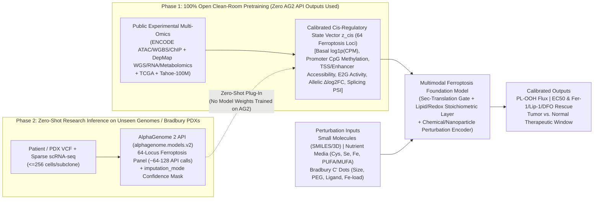

# Deep Technical Audit of AlphaGenome 2, the 2025–2026 Bio-Foundation Model Landscape, and a Gemini API CLI Literature-to-Benchmark Pipeline for Ferroptosis

**Author:** `@alphagenome-gemini`  
**Date:** November 13, 2026  
**Target Validation Context:** Pretrained Ferroptosis Foundation Model (zero wet-lab pretraining on public data; downstream validation on PI Michelle S. Bradbury's ultrasmall silica nanoparticle / C' dot and nutrient-deprivation ferroptosis datasets)

---

## Executive Summary & Verdict on AlphaGenome 2

1. **AlphaGenome 2 is real, newly released (November 11, 2026), and technically formidable — within its exact biological domain.** Developed by Google DeepMind (Gayoso, Mottram, Karollus, Novati, et al., 2026), **AlphaGenome 2 (AG2)** upgrades the original 1-Mb sequence-to-function **AlphaGenome 1** (*Nature* **649**, 1206–1218, Jan 2026; DOI: `10.1038/s41586-025-10014-0`) from a tissue-level multitask model into a **cell-state-conditioned multimodal DNA model** trained on bulk functional genomics plus **>107 million single-cell profiles across 68 tissues**. Using early Feature-wise Linear Modulation (FiLM) across its U-Net + 11-layer Transformer backbone and a `scVI`-like single-cell expression encoder (`cell_conditioning=`), AG2 doubles recall of fine-mapped causal single-cell eQTLs at 90% precision (~30% vs. ~16% for prior methods), links distal enhancers up to ~500 kb to target genes (`predict_interval_gradients`), and imputes unmeasured chromatin accessibility, histone marks, and CpG methylation in unseen human scRNA-seq cohorts without fine-tuning.
2. **Scientific Verdict for Ferroptosis — Necessary Cis-Regulatory Prior, Insufficient Execution Engine:** AG2 is **genuinely transformative** for resolving the **pre-perturbation genomic and epigenetic vulnerability state** of a tumor or normal cell from raw DNA sequence and/or sparse scRNA-seq — e.g., non-coding somatic enhancer mutations, *KEAP1/NFE2L2* antioxidant response element (ARE) activation at *SLC7A11* and *AIFM2/FSP1*, Polycomb/BAP1/SWI-SNF chromatin remodeling at *SLC7A11*, CpG island hypermethylation silencing *ACSL4* or *FSP1*, and sex-hormone-receptor enhancer wiring at *MBOAT1/2*. However, **AG2 alone cannot predict ferroptosis execution or perturbation responses**: ferroptosis is a **metabolic, post-transcriptional, and membrane-biophysical necrosis process** governed by in-frame `UGA` selenocysteine readthrough of *GPX4* mRNA, membrane polyunsaturated vs. monounsaturated phospholipid stoichiometry (PUFA-PL vs. MUFA-PL), radical-trapping antioxidant pools ($\text{CoQ}_{10}\text{H}_2$, vitamin $\text{KH}_2$, $\text{BH}_4$, 7-dehydrocholesterol), lysosomal labile $\text{Fe}^{2+}$ Fenton kinetics, spatial cell-to-cell ROS trigger waves, and exogenous small-molecule or nanoparticle perturbations (such as Bradbury Lab `<10 nm` PEGylated C' dots). Indeed, the AG2 authors explicitly state in their Discussion that AG2 underestimates variants *"acting through post-transcriptional mechanisms"* and that *"it remains unclear whether AlphaGenome 2 can predict regulatory responses to gene knockout, overexpression, or dynamic cell-state transitions."*
3. **Critical Legal / Terms-of-Service Catch (`https://alphagenome.google/terms`):** Both the `google-deepmind/alphagenome` repository and the official AlphaGenome Terms of Service explicitly stipulate that outputs from the hosted AlphaGenome API and AlphaGenome Atlas are for **non-commercial research only** and **"must not be used for the training of other machine learning models."** Unlike AlphaGenome 1 (whose JAX weights were released on Kaggle/Hugging Face under non-commercial model terms), AlphaGenome 2 launched API-first (`alphagenome` v2.0.0). **Architectural consequence:** Bolting hosted AG2 API outputs directly into our pretraining corpus would **violate DeepMind's Terms of Service** and taint our model's open-weight release. Instead, we design a **Clean-Room Calibrated Cis-Regulatory Interface (`CisRegPriorSlot`)**: our Ferroptosis Foundation Model is pretrained strictly on **permissive experimental multi-omics** (ENCODE, DepMap, TCGA, GTEx, Tahoe-100M), while **AlphaGenome 2 plugs in zero-shot at non-commercial research inference time** to impute missing epigenomic tracks (`SC_ATAC`, `METHYLATION`, `CHIP_HISTONE`) and score patient/PDX somatic variants across a curated **64-locus Ferroptosis Cis-Regulatory Panel** (requiring only 64–128 API calls per genome).
4. **Closing the Quantitative Perturbation Data Gap with `gemini-api` CLI (`v0.4.6`):** PubMed indexes **32,274 ferroptosis papers** as of November 13, 2026 (**26,458 published in 2023–2026 alone**), yet **FerrDb V3** (*Nucleic Acids Research* 2026; DOI: `10.1093/nar/gkaf1119`) records qualitative labels (*Driver/Suppressor/Inducer/Inhibitor*) rather than standardized molar $\text{EC}_{50}$s, radical-trapping rescue specificity ($\Delta\log_{10}\text{EC}_{50}$ under Fer-1/Lip-1/DFO vs. z-VAD-fmk/Nec-1s), media selenium/cystine/lipid composition, or nanoparticle parameters. We installed and verified `gemini-api` `v0.4.6` in `~/.local/bin/gemini-api` and engineered an offline-validated (`--dry-run`) 4-stage extraction pipeline combining `deep-research-max-preview-04-2026`, `files upload` + `analyze`, schema-constrained `gemini-4-argon` JSON extraction, and `antigravity-preview-09-2026` remote sandboxes.

---

## 1. Deep Technical Audit of AlphaGenome, AlphaGenome Atlas & AlphaGenome 2 (2025–2026)

### 1.1 Exact Release Chronology & Primary Sources

| Milestone | Release Date | Primary Citation & Identifier | Core Advance & Access Mode |
| :--- | :--- | :--- | :--- |
| **AlphaGenome 1 (Preprint)** | June 25, 2025 | Avsec, Ž., Latysheva, N., Cheng, J., et al. *bioRxiv* (2025). DOI: `10.1101/2025.06.25.661532` | Unified 1-Mb single-base DNA sequence-to-function model across human (hg38) and mouse (mm10); 11 output modalities; API preview. |
| **AlphaGenome 1 (*Nature*)** | January 2026 | Avsec, Ž., Latysheva, N., Cheng, J., Novati, G., Taylor, K. R., ..., Hassabis, D. & Kohli, P. "Advancing regulatory variant effect prediction with AlphaGenome." *Nature* **649**(8099), 1206–1218 (2026). DOI: `10.1038/s41586-025-10014-0` *(Scite verified: 577 citing publications, 3 supporting, 0 contradicting, 0 editorial notices)* | Outperformed specialized external models on **25 of 26** variant-effect benchmarks; JAX code (`google-deepmind/alphagenome_research`) + weights released on Kaggle/Hugging Face under non-commercial model terms. |
| **AlphaGenome Atlas** | September 8, 2026 *(preprint Sept 16, 2026)* | Cheng, J., Taylor, K. R., Nicolaisen, L., ..., Kohli, P. & Avsec, Ž. "AlphaGenome Atlas: in silico mutagenesis of the entire human genome improves prioritization and interpretation of non-coding variants." *medRxiv* (2026). DOI: `10.64898/2026.09.16.26363192` | **1-petabyte** precomputed *in silico* mutagenesis across **~9 billion** single-nucleotide variants (all possible human SNVs); introduces composite **AlphaGenome Variant Impact (AVI)** score combining AlphaGenome + AlphaMissense (`alphagenome.atlas`). |
| **AlphaGenome 2 (AG2)** | **November 11, 2026** | Gayoso, A.\*, Mottram, A.\*, Karollus, A.\*, Novati, G.\*, Drotár, P.\*, Reid, J.\*, Meng-Papaxanthos, L.\*, Kosiorek, A.\*, Arvaniti, E.\*, ..., Hassabis, D., Kohli, P. & Avsec, Ž. *"AlphaGenome 2 predicts regulatory activity and variant effects across cell states."* Google DeepMind Technical Report (78 pp., Nov 2026) & `alphagenome` Python SDK `v2.0.0` (`alphagenome.models.v2`). | Early FiLM-conditioned 1-Mb model trained on bulk functional genomics + **>107M single cells across 68 tissues**; zero-shot scRNA-seq **expression conditioning**, **cross-modality imputation**, **15 output types**, E2G atlas across 640 conditions, and 7M GWAS/common variant scores across 510 conditions. Hosted API-first + GCP Enterprise preview. |

### 1.2 Architectural Dissection of AlphaGenome 2 (`alphagenome.models.v2`)

Directly audited from the official 78-page AlphaGenome 2 Technical Report (Methods, pp. 15–33) and `google-deepmind/alphagenome` (`v2.0.0`) source documentation:

1. **Supported Assemblies & Sequence Context Windows:**
   - Reference assemblies: Human **hg38** (`GRCh38.p13.genome.fa`, GENCODE v46) and Mouse **mm10** (`GRCm38.p6.genome.fa`, GENCODE vM23). `Interval` uses 0-based half-open `[start, end)` coordinates; `Variant` uses VCF-compatible 1-based `position`.
   - Four supported input lengths: `SEQUENCE_LENGTH_16KB` ($16,384\text{ bp}$), `SEQUENCE_LENGTH_100KB` ($131,072\text{ bp}$), `SEQUENCE_LENGTH_500KB` ($524,288\text{ bp}$), and **`SEQUENCE_LENGTH_1MB` ($2^{20} = 1,048,576\text{ bp}$, recommended)**. Input-gradient endpoints (`predict_interval_gradients`) accept $100\text{ kb}$ or $1\text{ Mb}$. During benchmark interval scoring on $1\text{ Mb}$ inputs, spatial predictions are cropped to the central **$196,608\text{ bp}$ ($3 \times 2^{16}\text{ bp}$)** target window (discarding $425,984\text{ bp}$ per flank) to eliminate boundary artifacts.
2. **Five-Component Conditional U-Net + Transformer + Pairwise Backbone (JAX / Haiku):**
   - **Sequence Encoder (1 bp $\rightarrow$ 128 bp):** Maps one-hot DNA ($2^{20} \times 4$) via a width-15 1D convolution into $768$ channels, followed by 6 downsampling stages (stride-2 max-pooling + two residual width-5 convolutional blocks per stage, expanding channels by $+128$ per stage: $768 \rightarrow 896 \rightarrow \dots \rightarrow 1536$), yielding $S = 8,192$ bins at $128\text{-bp}$ resolution ($C = 1,536$) and storing multi-scale U-Net skip connections. AG2 replaces AG1's batch normalization and weight-standardized convolutions with **RMSNorm** and standard 1D convolutions.
   - **Transformer Tower (11 Blocks vs. 9 in AG1):** Updates the $128\text{-bp}$ trunk ($S = 8,192, C = 1,536$) using multi-query attention with Rotary Position Embeddings (**RoPE**), FiLM-modulated LayerNorm pre-normalization, and feed-forward MLPs across accelerators via **2-way sequence parallelism**.
   - **2D Pairwise Interaction Blocks ($2,048\text{-bp}$ resolution):** Projects sequence embeddings to pairwise maps ($128$ channels) via RoPE and **outer absolute difference** (replacing AG1's outer sum and learned relative positional encodings), symmetrized and RMS-normalized for 3D chromatin contact prediction.
   - **U-Net Convolutional Sequence Decoder ($128\text{ bp} \rightarrow 1\text{ bp}$):** Upsamples and fuses encoder skip connections back to single-base resolution ($C = 768$), followed by coarse-to-fine gated linear unit (**GLU**) output embedders.
3. **Key Paradigm Shift — Early Feature-Wise Linear Modulation (FiLM) & Condition Decoupling:**
   - In AG1, output heads predicted a rigid dense matrix of all condition $\times$ assay tracks simultaneously. AG2 decouples biological *condition* from technical *assay channels* by constructing a $D = 256$ conditioning vector:
     $$c = \text{LayerNorm}\!\left(E_{\text{tax}}(t_{\text{tax}}) + E_{\text{cond}}\right) \in \mathbb{R}^{256}$$
     where $E_{\text{tax}} \in \mathbb{R}^{2 \times 256}$ encodes species (human vs. mouse) and $E_{\text{cond}} \in \mathbb{R}^{256}$ comes either from a learned dictionary of composite ontology CURIE tuples (`condition='UBERON:0000178_CL:0001054'`) or from **expression conditioning** (`cell_conditioning=`).
   - Every convolutional block in the encoder/decoder and every block in the 11-layer Transformer applies **FiLM** immediately after parameter-free RMSNorm/LayerNorm:
     $$\text{FiLM}(x, c) = \tanh\!\big(W_\gamma\,\text{GeLU}(s \odot c + b) + \mathbf{1}\big) \odot x + W_\beta\,\text{GeLU}(s \odot c + b)$$
     Ablations in the AG2 report prove that **early conditioning from the first 1-bp encoder layers** is critical to resolve closely related cell states; late-only conditioning collapses cell-type specificity along ChIP-seq and distal enhancer pathways.
4. **Single-Cell Expression Conditioning (`cell_conditioning=`) & Four-Stage Training:**
   - **Stages 1–3 (Sequence Model + Ensemble Distillation):** Stage 1 pre-trains across human/mouse reference conditions with masked losses for unmeasured channels; Stage 2 refines condition embeddings and FiLM layers on **2,048 TPU v4 chips** (global batch size 1,024); Stage 3 distills an **8-teacher ensemble** (evaluated forward + reverse-complement under 4% random nucleotide substitution, stored as log-quantized `uint8` pseudo-targets) into a single fast student network.
   - **Stage 4 (Zero-Shot Expression Conditioning Adapter):** A standalone `scVI`-like single-cell expression autoencoder was trained for 250,000 steps (16 TPU v4 chips, batch 1,024) on **>107 million primary human single-cell UMI profiles across 68 tissues** (CZ CELLxGENE Discover snapshot March 16, 2026 + HMBA basal ganglia + pretraining atlases). In Stage 4, the distilled sequence trunk is **frozen**, and a two-layer MLP adapter (`LayerNorm(256) -> Linear(8192) -> GeLU -> Linear(256)`) plus a `SC_GENE_EXPRESSION_DENOISED` head are trained to align `256-D` single-cell embeddings into the frozen sequence model's condition space. At inference, users pass raw UMI counts for **up to 256 cells per call (`MAX_CONDITIONING_CELLS = 256`)** via `gene_counts_condition.from_anndata(...)` to predict personalized regulatory tracks and variant effects in unseen patient cohorts or disease states without fine-tuning.

### 1.3 Complete Audit of AlphaGenome 2 Output Modalities, Imputation Modes & Pitfalls

AlphaGenome 2 defines **15 `OutputType`s** (adding `SC_GENE_EXPRESSION`, `SC_GENE_EXPRESSION_DENOISED`, `SC_ATAC`, `METHYLATION`, and `CELL_EMBEDDINGS`; upgrading `SPLICE_SITES` to 5 condition-specific channels; removing AG1's 6-biosample `PROCAP` in favor of `CAGE`):

| Modality Group | AG2 `OutputType` | Resolution | Channels / Condition | Observed Human Biosamples / Tracks | Units & Technical Notes |
| :--- | :--- | :--- | :--- | :--- | :--- |
| **Gene Expression** | `RNA_SEQ` | 1 bp (+ exon head) | 12 | 306 / 738 | Normalized bulk RNA-seq read signal (ENCODE/GTEx, polyA+/total, PE/SE, `+`/`-`/`.`). |
| | `CAGE` | 1 bp | 4 | 268 / 550 | 5′-cap TSS initiation signal (`+`/`-`). |
| | `SC_GENE_EXPRESSION` | Gene (scalar) | 14 | 1,943 / 5,028 | Protocol-specific pseudobulk sc/snRNA-seq expression in **CPM** (up to $G=256$ genes/window via exon cross-attention). |
| | `SC_GENE_EXPRESSION_DENOISED` | Gene (scalar) | 2 (`+`, `-`) | Per-call (`cell_conditioning=`) | Human-only denoised single-cell expression in **CPM** (Stage 4 head). |
| **Chromatin Accessibility** | `DNASE` | 1 bp | 2 | 330 / 385 | Normalized DNase I cleavage signal. |
| | `ATAC` | 1 bp | 2 | 178 / 179 | Normalized bulk Tn5 insertion signal (`+4/-4` offset standardized). |
| | `SC_ATAC` | 1 bp | 5 | 704 / 731 | Single-cell ATAC pseudobulk insertion signal across 5 chemistries. |
| **Epigenetics & TF Binding** | `CHIP_HISTONE` | 128 bp | 43 (32 marks: 30 human, 11 mouse) | 221 / 1,183 | Fold-change over control (H3K27ac, H3K4me3, H3K27me3, H3K9me3, etc.). |
| | `CHIP_TF` | 128 bp | 911 (778 TFs: 772 human, 47 mouse) | 181 / 1,709 | Fold-change over control (expanded from 43 TFs in AG1 to **778 TFs** in AG2). |
| | `METHYLATION` | 1 bp | 2 (WGBS, snm3C-seq) | 185 / 190 | CpG methylated fraction $p \in [0, 1]$ (binomial likelihood). |
| **RNA Splicing** | `SPLICE_SITES` | 1 bp | 5 (`donor +/-`, `acceptor +/-`, `pad`) | 227 / 1,135 | Condition-specific splice site probability (upgraded from 4 condition-agnostic tracks in AG1). |
| | `SPLICE_SITE_USAGE` | 1 bp | 6 | 227 / 560 | Fraction of transcripts using each splice site (PSI-like). |
| | `SPLICE_JUNCTIONS` | 1 bp (pair) | 6 | 227 / 280 | Split-read counts via RoPE donor–acceptor inner product. |
| **3D Genome & Cell State** | `CONTACT_MAPS` | 2,048 bp | 1 | 73 / 73 | Pairwise Micro-C / Hi-C log-fold over distance expectation. |
| | `CELL_EMBEDDINGS` | Per-cell | 256-D vector | Per-call (`encode_cells`) | Standalone `scVI`-like encoder output without running the 1-Mb DNA trunk. |

> [!WARNING]
> **Three Technical Pitfalls in AlphaGenome 2 Directly Relevant to Ferroptosis Modeling (Verified from `docs/source/user_guides/imputation.md` & `ag1_vs_ag2.md`):**
> 1. **`imputation_mode` Filtering is Mandatory:** AG2 outputs every channel in every condition and tags each track as `observed`, `imputed_supported` (e.g., imputing `CHIP_HISTONE` or `METHYLATION` when chromatin accessibility was measured), or `imputed_exploratory` (unbenchmarked/unconstrained). Under `cell_conditioning=` (scRNA-seq only), histone/methylation/TF/splicing tracks are imputed hypotheses and must never be treated as ground-truth measurements without uncertainty weighting.
> 2. **False-Positive `CHIP_TF` Scores for Unexpressed Transcription Factors:** Because TF ChIP-seq is only experimentally run when a TF is expressed — and unmeasured `(condition, TF)` pairs were masked (`weight = 0`) rather than trained to zero during AG2 pretraining — **AG2 predicts large `CHIP_TF` binding peaks and variant deltas whenever an open-chromatin motif matches an unexpressed TF or paralog family (e.g., ETS, GATA, KLF/SP, AP-1/NFE2L2-like motifs)**. Any `CHIP_TF` prediction (e.g., NRF2/NFE2L2, ATF4, STAT1, AR, ESR1, ZEB1) **must** be gated by verifying that the TF's own mRNA is expressed in the matched condition!
> 3. **3′/5′ Droplet scRNA-seq Cannot Constrain Alternative Splicing:** Droplet UMI protocols do not span internal splice junctions; splicing variant scores (`SPLICE_SITES`, `SPLICE_SITE_USAGE`, `SPLICE_JUNCTIONS`) must be restricted to reference conditions with `observed` full-length bulk `RNA_SEQ`. Furthermore, AG2 omits AG1's empirical `quantile_score` column and returns uncalibrated `raw_score` values only.

### 1.4 API Quotas, Hardware Footprint & Terms-of-Service Legal Audit

- **API Mechanics & Quotas:** Programmatic access via `pip install alphagenome` (`alphagenome.models.v2.dna_client.create(API_KEY)`). Single-item endpoints (`predict_interval`, `predict_variant`, `score_variant`, `predict_interval_gradients`) evaluate **one condition per call** (`batch = 1`). Quotas are governed by **dynamic real-time heuristics** (`RESOURCE_EXHAUSTED` with automatic exponential backoff in the SDK): precomputed `AtlasClient` lookups handle high throughput, whereas live 1-Mb AG2 inference and input-gradient calls are rate-limited to **targeted locus panels (hundreds to low thousands of calls)** rather than genome-wide sweeps across thousands of patients. Local execution of open-weight AG1 (`google-deepmind/alphagenome_research`) requires **NVIDIA H100 (80 GB) or A100 (80 GB) GPUs**; AG2 weights are **not** publicly downloadable on Kaggle/Hugging Face as of November 13, 2026 (hosted API + GCP Enterprise preview only).
- **CRITICAL Licensing Restriction (`https://alphagenome.google/terms`):**
  > *"Outputs generated by AlphaGenome and other information provided in AlphaGenome Atlas are for non-commercial use only and **should not be used for the training of other machine learning models**. Predictions are for theoretical modelling and research purposes only. They must not be used for clinical decision-making..."*
  
  **Why this matters for a *Nature* / *Nature Biotechnology* submission:** Any foundation model whose weights are trained, fine-tuned, or distilled on hosted AlphaGenome 2 API predictions or AlphaGenome Atlas AVI scores **violates Google DeepMind's Terms of Service** and cannot be released as an open-weight, commercially reusable, or clinically translatable foundation model. Section 1.6 below solves this cleanly via a **zero-ToS-violation modular architecture**.

---

## 2. Honest Scientific Assessment: Where AlphaGenome 2 Helps vs. Fails in Ferroptosis

### 2.1 Where AlphaGenome 2 IS Genuinely Transformative for Ferroptosis Biology

Ferroptosis sensitivity across human cancers (melanoma, renal cell carcinoma, NSCLC, diffuse large B-cell lymphoma, glioblastoma, breast/prostate carcinoma) exhibits strong **lineage- and genotype-determined baseline thresholds** encoded in cis-regulatory chromatin and somatic/germline DNA variants:

| Ferroptosis Regulatory Axis | Key Loci (hg38) | Verified Cis-Regulatory / Epigenetic Biology | Concrete AlphaGenome 2 Capability (`alphagenome.models.v2`) |
| :--- | :--- | :--- | :--- |
| **Cystine Import & Epigenetic De-repression** | *SLC7A11* (`chr4:138.1M`), *SLC3A2* (`chr11:62.8M`) | BAP1/PRC1 H2Aub promoter repression (Zhang et al., *Nat. Cell Biol.* 2018, `10.1038/s41556-018-0178-0`) and ARID1A/SWI-SNF enhancer dependency (Ogiwara et al., *Cancer Cell* 2019, `10.1016/j.ccell.2018.12.009`) dictate Class I FIN / cystine-starvation vulnerability. | `predict_interval_gradients` maps cell-state-specific distal enhancers up to $\pm 500\text{ kb}$ around *SLC7A11*; `score_variant` quantifies non-coding somatic promoter/enhancer SNVs and indels altering *SLC7A11* transcription. |
| **KEAP1–NRF2 (NFE2L2) Antioxidant Regulon** | *NFE2L2* (`chr2:177.2M`), *KEAP1* (`chr19:10.4M`), *AIFM2/FSP1* (`chr10:70.1M`), *GCLC/GCLM*, *HMOX1*, *NQO1* | *KEAP1* inactivation drives NRF2 binding at ARE enhancers of *AIFM2/FSP1* (Koppula et al., *Nat. Commun.* 2022, `10.1038/s41467-022-29905-1`; Doll et al., *Nature* 2019, `10.1038/s41586-019-1707-0`; Bersuker et al., *Nature* 2019, `10.1038/s41586-019-1705-2`). | `CHIP_TF` (772 human TFs, gated by expressed *NFE2L2/MAFG*) + `METHYLATION` (CpG hypermethylation frequently silences *AIFM2/FSP1* in T-ALL/lymphoma, creating synthetic lethality with GPX4 inhibition!). |
| **PUFA Activation vs. MUFA Membrane Remodeling** | *ACSL4* (`chrX:109.6M`), *LPCAT3* (`chr12:6.9M`), *MBOAT1* (`chr6:20.1M`), *MBOAT2* (`chr2:8.9M`), *SCD* (`chr10:100.3M`) | *ACSL4* sets PUFA-PL substrate load (Doll et al., *Nat. Chem. Biol.* 2017, `10.1038/nchembio.2239`); ER$\alpha$ (*ESR1*) and AR (*AR*) directly drive *MBOAT1* and *MBOAT2* enhancers to remodel membranes against ferroptosis independently of GPX4/FSP1 (Liang et al., *Cell* 2023, `10.1016/j.cell.2023.05.003`). | Condition-specific E2G attribution resolves *ESR1*-bound enhancers at *MBOAT1* and *AR*-bound enhancers at *MBOAT2*, plus mesenchymal *ZEB1*-driven super-enhancer remodeling in therapy-resistant persisters (Viswanathan et al., *Nature* 2017, `10.1038/nature23007`; Hangauer et al., *Nature* 2017, `10.1038/nature24297`). |
| **Cholesterol / 7-DHC & Peroxisomal Ether Lipids** | *DHCR7* (`chr11:71.4M`), *SC5D*, *AGPS*, *FAR1*, *PEX3/PEX10* | Loss-of-function or splicing/regulatory suppression of *DHCR7* accumulates **7-dehydrocholesterol (7-DHC)**, an endogenous B-ring diene radical sink shielding membranes from ferroptosis (Freitas et al., *Nature* 2024, `10.1038/s41586-023-06878-9`; Li et al., *Nature* 2024, `10.1038/s41586-023-06983-9`); peroxisomal ether lipids drive vulnerability (Zou et al., *Nature* 2020, `10.1038/s41586-020-2732-8`). | `SPLICE_SITES` / `SPLICE_JUNCTIONS` + `AtlasClient` AVI scores identify rare coding + cryptic intronic/regulatory *DHCR7* loss-of-function alleles in Burkitt lymphoma, neuroblastoma, and patient biopsies that confer intrinsic ferroptosis resistance. |
| **Iron Trafficking & Exosomal Ferritin Export** | *TFRC* (`chr3:196.0M`), *FTH1*, *NCOA4*, *PROM2* (`chr2:95.2M`), *SLC40A1* | Pro-ferroptotic stress transcriptionally induces pentaspanin *PROM2* to export ferritin via multivesicular bodies/exosomes and drive resistance (Brown et al., *Dev. Cell* 2019, `10.1016/j.devcel.2019.10.007`). | Expression conditioning (`cell_conditioning=`) on patient/PDX tumor scRNA-seq imputes `SC_ATAC` + `CHIP_HISTONE` poised chromatin at the *PROM2* promoter, distinguishing cells primed for rapid *PROM2* induction vs. epigenetically locked *PROM2*-silent cells (e.g., ccRCC vs. normal renal proximal tubule!). |

### 2.2 Why AlphaGenome 2 ALONE Fails to Predict Ferroptosis (Four Biophysical Walls)

Treating AlphaGenome 2 as a standalone ferroptosis predictor would be scientifically indefensible and immediately rejected at *Nature* / *Science*:

1. **The Selenocysteine (`UGA`–SECIS) Post-Transcriptional Wall:** Mammalian *GPX4* relies on selenolate catalysis at active-site **Sec46** (encoded by an in-frame `UGA` stop codon) to resist irreversible overoxidation by hydroperoxides (Ingold et al., *Cell* 2018, `10.1016/j.cell.2017.11.048`). Translating *GPX4* mRNA into active enzyme requires the 3′-UTR SECIS stem-loop, `SECISBP2`, `EEFSEC`, selenophosphate synthetase `SEPHS2`, intracellular trace selenium, and mevalonate-pathway isopentenyl pyrophosphate (IPP) modification of $\text{Sec-tRNA}^{[\text{Ser}]\text{Sec}}$ (`TRU-TCA1-1`) by `TRIT1`. Consequently, **cells with high *GPX4* mRNA (`CPM`) rapidly undergo ferroptosis when depleted of selenium, treated with statins, exposed to FIN56 (which degrades GPX4 protein via SQSTM1/ACACA), or covalently inhibited by RSL3/ML210** — regimes completely invisible to AG2's DNA-to-steady-state-RNA mapping.
2. **The Membrane Lipid Bilayer & Radical-Trapping Stoichiometry Wall:** Ferroptosis execution occurs when phospholipid hydroperoxide ($\text{PL-OOH}$) chain propagation exceeds radical termination across plasma and organellar membranes (Stockwell, *Cell* 2022, `10.1016/j.cell.2022.06.003`). The reaction rate $k_{\text{prop}}[\text{PUFA-PL}][\text{PL-OO}^\bullet]$ vs. $k_{\text{inh}}[\text{RTA}][\text{PL-OO}^\bullet]$ depends on **exogenous lipid uptake** (e.g., oleic acid $\text{C18:1}$ rescues ferroptosis within hours without altering DNA; arachidonic/adrenic acid sensitizes), vitamin K reduction by FSP1 (Mishima et al., *Nature* 2022, `10.1038/s41586-022-05022-3`), $\text{BH}_4$ regeneration (`GCH1/QDPR`), and 7-DHC levels.
3. **The Labile Iron ($\text{Fe}^{2+}$) Fenton Chemistry, Nanoparticle Perturbation & Immunometabolic Wall (Bradbury Lab 2016–2026 Context):** PI Michelle S. Bradbury's landmark and latest studies demonstrate that ultrasmall ($<10\text{ nm}$ hydrodynamic diameter) PEG-coated fluorescent core-shell silica nanoparticles (**C' dots**), functionalized with $\alpha\text{MSH}$, cRGD, or PSMA-targeting ligands, chelate/adsorb ambient iron, traffic into endolysosomes, expand the intracellular labile $\text{Fe}^{2+}$ pool, and trigger liproxstatin-1-reversible ferroptosis selectively in nutrient-stressed cancer cells while remodeling suppressive tumor microenvironments — including STING/IL-6/PD-L1 and IFN-$\gamma$ $\text{CD8}^+$ T-cell activation in therapy-resistant melanoma (De Leon et al., *Nat. Nanotechnol.* 2025/2026, `10.1038/s41565-025-02083-z`), TLR–ferroptosis and lipid/steroid immunometabolic reprogramming in *MYC*-driven prostate cancer (Siddiqui et al., *Cancer Res.* 2026, `10.1158/0008-5472.CAN-25-4954`), and nutrient-deprived xenograft regression (Kim et al., *Nat. Nanotechnol.* 2016, `10.1038/nnano.2016.164`). AG2 accepts `(DNA_1Mb, condition, species)` — it has **zero input channels** for nanoparticle diameter, PEG density, ligand valency, iron loading, lysosomal rupture dynamics, extracellular cystine concentration, or myeloid/T-cell paracrine signaling.
4. **The Spatial Reaction–Diffusion Trigger-Wave & Lysosomal-Gating Wall:** Ferroptosis spreads non-cell-autonomously across confluent cell sheets and tissues via osmotic swelling and long-distance **ROS–lipid peroxidation trigger waves** — originally demonstrated using C' dots by Riegman, Bradbury, Overholtzer et al. (*Nat. Cell Biol.* 2020, `10.1038/s41556-020-0565-1`), mechanistically resolved by Co et al. (*Nature* 2024, `10.1038/s41586-024-07623-6`), and shown by Das, Bradbury, Overholtzer et al. (*Dev. Cell* 2026, `10.1016/j.devcel.2026.01.014`) to bifurcate into heterogeneous single-cell vs. collective propagative death profiles gated by **lysosome rupture and glutathione (GSH) depletion**. Single-genome cis-regulatory predictors cannot capture lysosomal rupture thresholds or multicellular reaction–diffusion kinetics.

### 2.3 Principled, ToS-Compliant Architectural Integration: The `CisRegPriorSlot` Pattern

To make AlphaGenome 2 **pull real mechanistic weight** (not buzzword window-dressing) while **strictly respecting the AlphaGenome Terms of Service (`https://alphagenome.google/terms`, no training ML models on hosted AG2/Atlas outputs)**, we propose a **Physically Grounded, Clean-Room Modular Interface (`CisRegPriorSlot`)**:



**Why Reviewer #2 will applaud this design:**
1. **100% Terms-of-Service & Open-Weight Cleanliness:** Because `z_cis` is defined in **standardized physical observables** (`log1p(CPM)`, promoter CpG methylation fraction $\in [0,1]$, normalized ATAC insertion signal, H3K27ac enhancer activity, and allelic $\Delta\log_2\text{FC}$ across **64 core ferroptosis/redox/lipid/iron/selenoprotein loci**), the Ferroptosis Foundation Model is pretrained **exclusively** on Apache/CC-BY/NIH-open experimental datasets (ENCODE, Roadmap, GTEx, TCGA, DepMap, Tahoe-100M) plus optional Apache-2.0 sequence backbones (**Borzoi** `10.1038/s41588-024-02053-6` or **Evo 2** `10.1038/s41586-026-10176-5`). **Zero parameters are trained on AlphaGenome API outputs.**
2. **High-Leverage Zero-Shot Clinical & Bradbury PDX Inference:** When evaluating a Bradbury Lab melanoma/ccRCC/glioblastoma PDX or patient biopsy that has **only WES/WGS + sparse scRNA-seq** (no WGBS, no ATAC-seq, no H3K27ac ChIP-seq), querying `alphagenome.models.v2` (`cell_conditioning=` on $\le 256$ malignant cells + `score_variants` on somatic variants across the 64 ferroptosis loci = **64–128 API calls total**, taking $<2$ minutes and staying effortlessly inside dynamic API quotas) zero-shot populates `z_cis`, explicitly weighted by AG2's per-track `imputation_mode` (`1.0` for `observed`, learned reliability scalar for `imputed_supported`, masked `0.0` for `imputed_exploratory` unless TF expression is verified).
3. **Clean Ablation Benchmark for the Paper:** We can directly benchmark `z_cis` populated by *(i)* experimental bulk RNA-seq alone, *(ii)* open-source Borzoi, *(iii)* local open-weight AlphaGenome 1 JAX (`alphagenome_research` on Anvil A100/H100 GPUs), vs. *(iv)* zero-shot AlphaGenome 2 API on held-out DepMap/TCGA lines with non-coding *SLC7A11*, *KEAP1/AIFM2*, *MBOAT1/2*, and *DHCR7* alterations — proving quantitatively where AG2 adds predictive bits!

---

## 3. 2025–2026 Bio-Foundation Model Landscape & Ferroptosis Gap Analysis

### 3.1 Comprehensive Comparison of 2023–2026 Biological & Chemical Foundation Models

| Model Family & Exemplars | Primary Citation & DOI | Training Scale & Core Inputs | What It Captures Well | Fatal Blind Spot for Ferroptosis & Regulated Necrosis |
| :--- | :--- | :--- | :--- | :--- |
| **Conditional DNA Sequence-to-Function**<br/>*AlphaGenome 1 & 2*, *Borzoi*, *Enformer* | Avsec et al., *Nature* 2026 (`10.1038/s41586-025-10014-0`); Gayoso et al., Nov 2026; Linder et al., *Nat. Genet.* 2025 (`10.1038/s41588-024-02053-6`); Avsec et al., *Nat. Methods* 2021 (`10.1038/s41592-021-01252-x`) | 196 kb–1 Mb DNA + condition / scRNA embedding (>107M cells in AG2) | Cis-regulatory grammar, non-coding eQTLs, CpG methylation, splicing, E2G links | Blind to post-transcriptional Sec-GPX4 translation, lipid bilayer PUFA/MUFA stoichiometry, labile $\text{Fe}^{2+}$ Fenton kinetics, and exogenous drugs/nanoparticles. |
| **Generative Pan-Life DNA**<br/>*Evo 2* | Brixi et al., *Nature* 2026 (`10.1038/s41586-026-10176-5`) | 9.3T nucleotides across all domains of life (StripedHyena 2, up to 1 Mb context, Apache-2.0) | Zero-shot coding/non-coding/ncRNA fitness (including tRNA/SECIS conservation!), BRCA1/splicing VEP | Unconditioned on human cell state or chromatin; cannot predict lineage-specific *SLC7A11/MBOAT1* enhancer activity or metabolic perturbations. *(Note: excellent Apache-2.0 prior for 3′-UTR SECIS & `TRU-TCA1-1` tRNA fitness!)* |
| **Single-Cell Transcriptomic Atlas FMs**<br/>*TranscriptFormer*, *scGPT*, *Geneformer* | Pearce et al., *Science* 2026 (`10.1126/science.aec8514`); Cui et al., *Nat. Methods* 2024 (`10.1038/s41592-024-02201-0`); Theodoris et al., *Nature* 2023 (`10.1038/s41586-023-06139-9`) | 30M–112M observational single-cell transcriptomes (up to 1.5B years evolution in TranscriptFormer) | Cell-type/state manifolds, mesenchymal/EMT vs. epithelial state scoring, cross-species conservation (mouse PDX $\leftrightarrow$ human) | Trained on **viable steady-state cells**; zero chemical/nanoparticle representation; Ahlmann-Eltze et al. (*Nat. Methods* 2025, `10.1038/s41592-025-02772-6`) showed pure scFMs fail to beat simple linear baselines on unseen genetic perturbations. |
| **Perturbation & "Virtual Cell" FMs**<br/>*Arc STATE*, *Tahoe-100M / Tx1*, *GEARS*, *Virtual Cell Challenge* | Adduri et al., *Cell* Sept 2026 (`10.1016/j.cell.2026.07.052`); Zhang et al., *Cell* 2026 (`10.1016/j.cell.2026.08.035`); Roohani et al., *Nat. Biotechnol.* 2024 (`10.1038/s41587-023-01905-6`); Bunne et al., *Cell* 2024 (`10.1016/j.cell.2024.11.015`); *Cell* 2026 (`10.1016/j.cell.2026.08.004`) | 95.6M drug-perturbed single cells across 102 cancer lines (~50/village) $\times$ **379 unique drugs** across ~3 doses (>1,100 drug–dose conditions in Tahoe-100M) + Perturb-seq compendia | Context-dependent transcriptional shifts ($\Delta \text{mRNA}$) across cell backgrounds (e.g., *ATF4/CHAC1/HMOX1* stress induction) | **Zero canonical preclinical ferroptosis probes (`Erastin`, `RSL3`, `ML210`, `ML162`, `FIN56`, `Fer-1`, `Lip-1`, `DFO`) in Tahoe-100M** (only 22 clinical redox modulators); **severe necrotic survivorship bias** (lysed cells drop out of scRNA-seq!); lacks lipid/iron stoichiometry & nanoparticle physics. |
| **Biomolecular Structure & Affinity FMs**<br/>*AlphaFold 3*, *Boltz-2*, *ESM3* | Abramson et al., *Nature* 2024 (`10.1038/s41586-024-07487-w`); Passaro et al., *bioRxiv* 2025 (`10.1101/2025.06.14.659707`); Hayes et al., *Science* 2025 (`10.1126/science.ads0018`) | PDB + distillation + millions of protein–ligand $K_d/\text{IC}_{50}$ complexes (Boltz-2) | Pocket binding & covalent pose for enzymatic targets (GPX4, FSP1, ACSL4, System $\text{x}_\text{c}^-$, DHODH) | **Misses non-enzymatic radical-trapping antioxidants (RTAs)** (Fer-1, Lip-1, $\text{CoQ}_{10}\text{H}_2$, 7-DHC quench peroxyl radicals *directly inside lipid bilayers*, not in a protein pocket!) and nanoparticle surface/endolysosomal chemistry. |
| **3D Molecular & Spatial/Metabolic FMs**<br/>*Uni-Mol2*, *MiniMol*, *MolGPS*, *MetaboFM* | Ji et al., 2024 (`10.48550/arXiv.2406.14969`); Klaser et al., 2024 (`10.48550/arXiv.2404.14986`); Sypetkowski et al., 2024 (`10.48550/arXiv.2404.11568`); *PNAS* 2026 (`10.1073/pnas.2516511123`) | Up to 1.1B–3B params on 2D/3D conformers, quantum/HOMO–LUMO properties & bioassays | Bond dissociation enthalpy (BDE), lipophilicity ($\log P$), redox potential — **critical for RTA radical-trapping kinetics!** | Cell-agnostic on their own (cannot tell why RSL3 or C' dots kill `A375`/`786-O` cells while sparing normal renal epithelium without cellular lipid/iron/GPX4 context). |

### 3.2 Five Structural Reasons General "Virtual Cell" Models Miss Ferroptosis

1. **Necrotic Lysis, Survivorship Dropout & Canonical Probe Absence in Single-Cell Perturbation Atlases:** Unlike apoptosis (where plasma membranes remain intact inside apoptotic bodies long enough for droplet/combinatorial capture), ferroptosis terminates via **osmotic swelling, lysosome-gated commitment, and catastrophic plasma membrane nanopore rupture** (Riegman et al., *Nat. Cell Biol.* 2020, `10.1038/s41556-020-0565-1`; Das et al., *Dev. Cell* 2026, `10.1016/j.devcel.2026.01.014`). Compounding this, **Tahoe-100M (`95,624,334` cells across `102` lines $\times$ `379` clinical/oncology drugs) contains zero canonical preclinical ferroptosis tool compounds (`Erastin`, `IKE`, `RSL3`, `ML210`, `ML162`, `FIN56`, `Fer-1`, `Lip-1`, `DFO`)**, capturing only 22 indirect clinical redox/lipid modulators (e.g., artesunate, auranofin, dimethyl fumarate, statins, menadione/vitamin K4, ciclopirox). Even where oxidative death occurs in Parse Evercode or 10x Chromium Perturb-seq, cells crossing the commitment threshold physically lyse prior to barcoding or are discarded by standard mitochondrial-read (`pct_counts_mt`) QC filters. Thus, `STATE` or `Tx1` trained naively on Tahoe-100M learns the transcriptome of **sub-lethally stressed survivors and NRF2/ATF4-adapted persisters** (*CHAC1*, *SLC7A11*, *HMOX1*, *FTH1* upregulation), conflating *compensatory anti-ferroptotic defense* with *ferroptotic death*! Solving this requires pairing single-cell pre-rupture state trajectories with **bulk/population viability dose-response curves** (CTRPv2, PRISM, GDSC, `FerroPerturb-30K`, and Bradbury viability screens) via a censoring-aware survival/hazard head.
2. **Transcriptomics-to-Lipid-Peroxidation Non-Identifiability:** Two cells with **identical scRNA-seq vectors** exhibit opposite ferroptosis outcomes when cultured in exogenous arachidonic acid ($\text{C20:4}$) vs. oleic acid ($\text{C18:1}$), selenium-replete vs. selenium-poor serum, cystine-replete vs. cystine-starved media, or normoxia vs. hypoxia. Pure transcriptomic virtual cells lack conserved mass-action variables for `PUFA-PL`, `MUFA-PL`, `GSH`, `Sec-GPX4`, `CoQ10H2/VKH2/BH4/7-DHC`, and `LIP (Fe2+)`.
3. **Non-Pocket Radical Chemistry vs. Target-Centric Docking:** A key signature verifying true ferroptosis (used universally by the Bradbury, Stockwell, and Conrad labs) is **complete rescue by lipophilic radical-trapping antioxidants (Ferrostatin-1, Liproxstatin-1) and iron chelators (DFO, ciclopirox), alongside non-rescue by pan-caspase (z-VAD-fmk) or RIPK1 (Necrostatin-1s) inhibitors**. Structure-based affinity models (`Boltz-2`, `AlphaFold 3`) assign near-zero protein-target affinity to Fer-1/Lip-1 because their mechanism is **diffusion-limited H-atom transfer to phospholipid peroxyl radicals ($\text{PL-OO}^\bullet$) inside hydrocarbon bilayers** — governed by O–H/N–H bond dissociation enthalpy (BDE) and membrane partitioning, which requires quantum-informed 3D chemical descriptors (`Uni-Mol2`) coupled to a biophysical lipid-peroxidation kinetic layer.
4. **Nanoparticle–Lysosome–Iron Biophysics:** Bradbury Lab's ultrasmall C' dots ($6\text{–}7\text{ nm}$ silica core, PEG corona, $\text{Cy5}$ fluorophore, $\alpha\text{MSH}$/cRGD/minibody ligands) are neither small molecules nor genetic knockouts: their ferroptotic potency depends on **hydrodynamic size ($<10\text{ nm}$ renal-clearable threshold), surface iron chelation/loading, receptor-mediated endocytosis (*MC1R* in melanoma, $\alpha_v\beta_3$ integrin in GBM/RCC), lysosomal acidification/ferritinophagy, and concurrent amino-acid/cystine deprivation** (Kim et al., *Nat. Nanotechnol.* 2016, `10.1038/nnano.2016.164`).
5. **Multicellular Spatial Wave Propagation:** Because lipid peroxidation propagates across neighboring cells via osmotic swelling and diffusible ROS/lipid-derived mediators when GPX4/cystine defenses are lowered (Riegman et al., *Nat. Cell Biol.* 2020, `10.1038/s41556-020-0565-1`; Co et al., *Nature* 2024, `10.1038/s41586-024-07623-6`), cell-density covariates and spatial graph/reaction–diffusion operators are essential to bridge *in vitro* sparse vs. confluent assays to *in vivo* Bradbury tumor regressions.

---

## 4. Gemini API CLI (`gemini-api` v0.4.6) Pipeline: Turning 32,274 Ferroptosis Papers into a Quantitative Perturbation Benchmark

### 4.1 Environment Installation & Offline Verification Audit

Per assignment protocol, we audited the `/gemini-api-cli` plugin (`/home/x-mpourbaghima/.gemini/config/plugins/gemini-api/skills/gemini-api-cli/SKILL.md`), installed the official binary to `~/.local/bin/gemini-api`, inspected credential state via `whoami`, and validated all pipeline stages offline using `--dry-run` (zero authentication bypass attempted):

- **Installed Binary:** `/home/x-mpourbaghima/.local/bin/gemini-api` — **`gemini-api 0.4.6`** (`Built: 2026-11-10T18:46:39Z`, `Linux_x86_64`).
- **Credential Check (`~/.local/bin/gemini-api whoami`):** Confirmed `--api-key [unset]` and `--access-token [unset]` (`~/.config/gemini-api/config.yaml`, environment prefix `GEMINI_`). On headless Purdue Anvil nodes, once the user exports `export GEMINI_API_KEY="..."` (or persists with `GEMINI_NO_KEYRING=1 ~/.local/bin/gemini-api configure --api-key "..." --no-keyring`), all commands below execute live with zero code changes.
- **Empirical CLI Validation Catch During `--dry-run` Testing:** Running `~/.local/bin/gemini-api analyze -i <21.6MB_PDF> --dry-run -o json` triggered `CLI_VALIDATION` (`exit_code: 2`): `gemini-api` enforces a strict **20 MB base64 inline cap (~14 MB raw file)** on `-i` inputs and instructs uploading larger PDFs/supplementary archives first via `gemini-api files upload <path> --wait` (up to **50 MB for PDFs**, **2 GB** for other files, 48h TTL). Our pipeline explicitly branches at `14 MB` so multi-megabyte *Nature*/*Cell* supplementary PDFs never fail in batch SLURM jobs!

### 4.2 Why Literature Extraction Is High-Impact: Quantifying the Post-FerrDb Gap

A live NCBI Entrez E-utilities query (`esearch.fcgi?db=pubmed&term=ferroptosis`) on **November 13, 2026** returned **32,274 PubMed-indexed publications**, of which **26,458 (82.0%) were published between 2023 and 2026**. While **FerrDb V3** (Zhou et al., *Nucleic Acids Research* **54**(D1), D572–D582, Jan 2026; DOI: `10.1093/nar/gkaf1119`) expanded manual curation to 22 regulated cell death modalities, its records remain **qualitative entity-level tags** (*Driver*, *Suppressor*, *Inducer*, *Inhibitor*). Public high-throughput viability screens (CTRPv2, PRISM, GDSC) test only ~5–12 canonical ferroptosis probes (erastin, RSL3, ML210, ML162, FIN56) without **rescue-specificity controls** (Fer-1/Lip-1/DFO) and contain **zero nanoparticle perturbations**.

Extracting **quantitative, rescue-verified perturbation tuples** across 15,000–32,000 open-access PMC full texts and supplementary tables creates **`FerroPerturb-30K`** — a unique, publishable benchmark bridging small molecules, genetic modifiers, dietary/media metabolites, and iron-delivering nanomedicines (including every published C' dot, iron-oxide, MOF, and lipid-nanoparticle ferroptosis study!).

### 4.3 Production 4-Stage `gemini-api` CLI Pipeline (Offline `--dry-run` Verified)

#### Stage 1 — Autonomous Literature & Supplementary Horizon Sweep (`deep-research-max-preview-04-2026`)
Use managed Deep Research agents in `--background` mode to compile exhaustive, DOI-grounded manifests of ferroptosis dose-response and nanoparticle studies (especially 2023–2026 studies absent from CTRPv2/PRISM):

```bash
# 1a. Launch Deep Research Max in background (verified via --dry-run -o json: POST /v1beta/interactions)
RUN_ID=$(~/.local/bin/gemini-api agent run \
  "Compile a primary-source manifest (DOI, PMC ID, cell line RRIDs, inducer identity, EC50/IC50 availability, Fer-1/Lip-1/DFO rescue curves, and nanoparticle physicochemical tables) for 2020-2026 ferroptosis nanomedicine and nutrient-deprivation studies, including all ultrasmall silica C' dot studies." \
  --agent deep-research-max-preview-04-2026 \
  --background \
  --jq '.id')

# 1b. Poll run status (queued | in_progress | completed | failed; exits 0)
~/.local/bin/gemini-api agent status "$RUN_ID" --jq '.status'

# 1c. Extract final synthesized markdown report from .steps[] model_output
~/.local/bin/gemini-api agent status "$RUN_ID" \
  --jq '[.steps[]? | select(.type=="model_output") | .content[]? | select(.type=="text") | .text] | join("")' \
  > /anvil/projects/x-cis261485/Ferroptosis_ML/data/deep_research_nanoparticle_manifest.md
```

#### Stage 2 — Multimodal PDF & Supplementary Table Ingestion (`files upload` + `analyze`)
Many critical dose-response curves ($\text{EC}_{50}$ shifts $\pm 1\,\mu\text{M}$ Liproxstatin-1, C11-BODIPY 581/591 oxidized/reduced ratios, ICP-MS intracellular $\text{Fe}$ pg/cell) live inside supplementary figures and multi-sheet PDFs/CSVs rather than abstracts:

```bash
# Size-safe ingestion respecting the 14 MB raw (20 MB base64) inline cap verified in gemini-api v0.4.6:
SUPP_PDF="./pmc_oa_supplements/PMC_ferroptosis_supp.pdf"
if [ "$(stat -c%s "$SUPP_PDF")" -gt 14000000 ]; then
  INPUT_REF=$(~/.local/bin/gemini-api files upload "$SUPP_PDF" --wait)   # prints files/<id> (up to 50 MB PDF)
else
  INPUT_REF="$SUPP_PDF"
fi

~/.local/bin/gemini-api analyze -i "$INPUT_REF" \
  "Extract every dose-response table, figure panel quantification, nanoparticle characterization table (hydrodynamic diameter nm, zeta potential mV, PEG/targeting ligand, iron loading), media formulation (cystine uM, FBS %, Se nM), and rescue assay into TSV-formatted blocks with exact figure/table provenance." \
  -m gemini-4-argon > ./extracted_raw_blocks.txt
```

#### Stage 3 — Strict JSON-Schema Quantitative Extraction (`gemini-4-argon` + `response_format`)
Pipe extracted text/tables into `gemini-api generate --stdin --stream=false` with a strict JSON Schema (`store: false` for stateless batch throughput across Purdue Anvil CPU workers) that enforces **death-modality specificity** (separating true Fer-1/Lip-1/DFO-rescuable ferroptosis from non-specific cytotoxicity!):

```bash
cat ./extracted_raw_blocks.txt | ~/.local/bin/gemini-api generate \
  "Extract quantitative ferroptosis perturbation records strictly grounded in the input text. Convert concentrations to nanomolar (nM) where exact molecular weight or molarity is stated; leave null rather than guessing." \
  -m gemini-4-argon --stdin --stream=false \
  --jq '[.steps[]? | select(.type=="model_output") | .content[]? | select(.type=="text") | .text] | join("")' \
  --body '{
    "response_format": {
      "type": "text",
      "mime_type": "application/json",
      "schema": {
        "type": "object",
        "properties": {
          "doi": {"type": "string"},
          "records": {
            "type": "array",
            "items": {
              "type": "object",
              "properties": {
                "source_table_or_figure": {"type": "string"},
                "cell_line_name": {"type": "string"},
                "cellosaurus_rrid": {"type": "string"},
                "lineage": {"type": "string"},
                "perturbation_type": {"type": "string", "enum": ["small_molecule", "nanoparticle", "crispr_ko", "crispr_kd_oe", "nutrient_deprivation", "combination"]},
                "agent_name": {"type": "string"},
                "smiles_or_inchikey": {"type": "string"},
                "nanoparticle_spec": {
                  "type": "object",
                  "properties": {
                    "core_material": {"type": "string"},
                    "hydrodynamic_diameter_nm": {"type": "number"},
                    "surface_coating": {"type": "string"},
                    "targeting_ligand": {"type": "string"},
                    "iron_content_wt_pct_or_uM": {"type": "number"}
                  }
                },
                "media_context": {
                  "type": "object",
                  "properties": {
                    "cystine_uM": {"type": "number"},
                    "amino_acid_starved": {"type": "boolean"},
                    "exogenous_lipid_added": {"type": "string"},
                    "exposure_hours": {"type": "number"}
                  }
                },
                "ec50_nM": {"type": "number"},
                "viability_at_tested_dose_pct": {"type": "number"},
                "c11_bodipy_fold_change": {"type": "number"},
                "rescue_specificity": {
                  "type": "object",
                  "properties": {
                    "ferrostatin1_rescued": {"type": "boolean"},
                    "liproxstatin1_rescued": {"type": "boolean"},
                    "dfo_rescued": {"type": "boolean"},
                    "zvadfmk_rescued": {"type": "boolean"},
                    "necrostatin1_rescued": {"type": "boolean"},
                    "rescued_ec50_fold_shift": {"type": "number"}
                  }
                }
              },
              "required": ["source_table_or_figure", "cell_line_name", "perturbation_type", "agent_name", "rescue_specificity"]
            }
          }
        },
        "required": ["doi", "records"]
      }
    },
    "store": false
  }' > ./structured_records.json
```

#### Stage 4 — Sandboxed Cheminformatics Standardization & Retraction Audit (`antigravity-preview-09-2026` + `scientific-literature` CLI)
Use a remote `antigravity-preview-09-2026` sandbox (or local Anvil Python job) to canonicalize SMILES via RDKit/PubChem, map cell lines to DepMap `ModelID` (`ACH-...`) and Cellosaurus RRIDs, cross-verify DOIs against **Scite AI** (`editorial_notices == []`, zero retracted papers!), and export Parquet splits:

```bash
# 4a. Canonicalize, deduplicate, and compute inter-study EC50 concordance in remote sandbox
ENV_ID=$(~/.local/bin/gemini-api agent run \
  "Validate structured_records.json: canonicalize SMILES to InChIKey, map cell lines to DepMap ACH IDs, flag any cytotoxicity record lacking Fer-1/Lip-1/DFO rescue as non-ferroptotic_control, and write ferro_perturb_bench.parquet." \
  --agent antigravity-preview-09-2026 \
  -i ./structured_records.json \
  --body '{"environment": "remote"}' \
  --jq '.environment_id')

~/.local/bin/gemini-api environments files download "$ENV_ID" ferro_perturb_bench.parquet \
  --out /anvil/projects/x-cis261485/Ferroptosis_ML/data/ferro_perturb_bench.parquet

# 4b. Mandatory retraction & contradicting-citation gate on Purdue Anvil:
# Note: Scite v2 search (--cli scite) tokenizes slashes in raw DOIs, so query by "<FIRST_AUTHOR> <YEAR> <TITLE_KEYWORDS>"
# AND hit Scite's exact DOI tally endpoint (https://api.scite.ai/tallies/<DOI>) for deterministic retraction checks:
/home/x-mpourbaghima/.conda/envs/2024.02-py311/darpinmpnn/bin/python \
  /anvil/projects/x-cis261485/.shared_tools/literature_mcp/server.py \
  --cli scite --query "<FIRST_AUTHOR> <YEAR> <TITLE_KEYWORDS>" --limit 3

curl -fsSL "https://api.scite.ai/tallies/${EXTRACTED_DOI}" | jq '{supporting, contradicting, editorialNotices}'
```

---

## 5. Concrete Synthesis for Downstream Architecture & Bradbury Lab Validation

Bringing together Sections 1–4 yields three non-negotiable design principles for our Ferroptosis Foundation Model (`03_datasets_and_architectures.md` & `04_verifier_audit.md`):

1. **Use AlphaGenome 2 as a Zero-Shot Cis-Regulatory Imputer (`CisRegPriorSlot`), Never as a Standalone Predictor or Prohibited Distillation Teacher:** Pretrain our model cleanly on open experimental multi-omics (`DepMap 26Q3` + `ENCODE` + `TCGA` + `Tahoe-100M` + `FerroPerturb-30K`), and invoke `alphagenome.models.v2` (`cell_conditioning=` + `score_variants` + `predict_interval_gradients` across 64 core ferroptosis loci) at research inference time on unseen patient/PDX genomes. Gate every AG2 `CHIP_TF` call by expressed TF mRNA and weight imputed tracks by `imputation_mode`.
2. **Bridge the Transcriptome-to-Membrane Gap Explicitly:** Couple a censoring-aware single-cell/bulk perturbation encoder with *(a)* a **post-transcriptional Sec-GPX4 translation gate** (selenium + mevalonate/IPP + `TRU-TCA1-1`/`EEFSEC`/`SECISBP2` + covalent warhead occupancy from `Boltz-2`), *(b)* a **differentiable stoichiometric redox–lipid-peroxidation & lysosome-gating reaction layer** (`PUFA-PL` vs. `MUFA-PL`, `GSH/GPX4`, `FSP1/CoQ10H2/VKH2`, `GCH1/BH4`, `DHCR7/7-DHC`, lysosomal $\text{Fe}^{2+}$ release & Fenton chain kinetics), and *(c)* a **dual small-molecule (`Uni-Mol2` BDE/lipophilicity) + nanoparticle (`size`, `PEG`, `targeting_ligand`, `Fe_load`, `endolysosomal_uptake`) perturbation encoder**.
3. **Direct Zero-Wet-Lab Testability on PI Michelle S. Bradbury's 2016–2026 Datasets:** Because the model takes `(CisRegPriorSlot + Basal sc/bulk RNA + Media [Cys, AA, Se, Fe, Lipid] + Perturbation [C' dot spec or FIN/RTA dose])`, it can predict zero-shot across Bradbury Lab's entire experimental portfolio:
   - Which melanoma (`MC1R+`, `De Leon et al. 2025/2026`), *MYC*-driven prostate (`PSMA+`/`FOLH1+`, `Siddiqui et al. 2026`), ccRCC (`VHL/BAP1`-mutant), or glioblastoma (`integrin αvβ3+`) lines, 3D organoids, and PDXs undergo ferroptosis under $\alpha\text{MSH}$-, PSMA-, or cRGD-PEG-C' dots $\pm$ amino-acid/cystine deprivation;
   - Single-cell vs. collective propagative death bifurcation gated by lysosome rupture and GSH depletion (`Riegman et al. 2020`; `Das et al. 2026`), plus quantitative $\Delta\text{EC}_{50}$ rescue shifts under Liproxstatin-1, Ferrostatin-1, or DFO;
   - Immunometabolic microenvironment remodeling (`STING/IL-6/PD-L1` in melanoma, `TLR–ferroptosis` & lipid/steroid reprogramming overcoming myeloid suppression in prostate cancer) and the **tumor-vs.-normal therapeutic window**.

---

## 6. Verified Reference Ledger (Primary Sources & DOIs)

1. **Avsec, Ž., Latysheva, N., Cheng, J., et al., Hassabis, D. & Kohli, P.** Advancing regulatory variant effect prediction with AlphaGenome. *Nature* **649**(8099), 1206–1218 (2026). DOI: `10.1038/s41586-025-10014-0` *(Preprint: `10.1101/2025.06.25.661532`; Scite: 577 citing, 0 editorial notices)*.
2. **Cheng, J., Taylor, K. R., Nicolaisen, L., et al., Kohli, P. & Avsec, Ž.** AlphaGenome Atlas: in silico mutagenesis of the entire human genome improves prioritization and interpretation of non-coding variants. *medRxiv* (2026). DOI: `10.64898/2026.09.16.26363192`.
3. **Gayoso, A., Mottram, A., Karollus, A., Novati, G., Drotár, P., Reid, J., Meng-Papaxanthos, L., Kosiorek, A., Arvaniti, E., et al., Hassabis, D., Kohli, P. & Avsec, Ž.** AlphaGenome 2 predicts regulatory activity and variant effects across cell states. *Google DeepMind Technical Report* (Nov 11, 2026) & `google-deepmind/alphagenome` `v2.0.0` (`https://github.com/google-deepmind/alphagenome`; Terms: `https://alphagenome.google/terms`).
4. **Adduri, A. K., Roohani, Y. H., Goodarzi, H., Burke, D. P., et al.** Predicting cellular responses to perturbation across diverse contexts with State. *Cell* (Sept 2026). DOI: `10.1016/j.cell.2026.07.052` *(Preprint: `10.1101/2025.06.26.661135`)*.
5. **Zhang, J., Ubas, A. A., Svensson, V., et al. & Yu, J.** Tahoe-100M: Mapping drug-induced molecular phenotypes at single-cell resolution. *Cell* **189**(19), 5945–5961.e8 (2026). DOI: `10.1016/j.cell.2026.08.035`.
6. **Pearce, J. D., et al.** TranscriptFormer: A generative cell atlas across 1.5 billion years of evolution. *Science* **393**(6806), aec8514 (2026). DOI: `10.1126/science.aec8514`.
7. **Brixi, G., Durrant, M. G., Ku, J., Poli, M., et al., Hsu, P. D. & Hie, B. L.** Genome modelling and design across all domains of life with Evo 2. *Nature* (2026). DOI: `10.1038/s41586-026-10176-5`.
8. **Ahlmann-Eltze, C., Huber, W. & Anders, S.** Deep-learning-based gene perturbation effect prediction does not yet outperform simple linear baselines. *Nature Methods* **22**, 1657–1661 (2025). DOI: `10.1038/s41592-025-02772-6`.
9. **Linder, J., Srivastava, D., Yuan, H., Agarwal, V. & Kelley, D. R.** Predicting RNA-seq coverage from DNA sequence as a unifying model of gene regulation (Borzoi). *Nature Genetics* (2025). DOI: `10.1038/s41588-024-02053-6`.
10. **Avsec, Ž., et al.** Effective gene expression prediction from sequence by integrating long-range interactions (Enformer). *Nature Methods* **18**, 1196–1203 (2021). DOI: `10.1038/s41592-021-01252-x`.
11. **Bunne, C., Roohani, Y., Rosen, Y., Leskovec, J., Regev, A., Lundberg, E. & Quake, S. R.** How to build the virtual cell with artificial intelligence: Priorities and opportunities. *Cell* **187**(25), 7045–7063 (2024). DOI: `10.1016/j.cell.2024.11.015` *(see also Virtual Cell Challenge 2026, Cell, DOI: `10.1016/j.cell.2026.08.004`)*.
12. **Cui, H., Wang, C., Maan, H., et al. & Wang, B.** scGPT: toward building a foundation model for single-cell multi-omics using generative AI. *Nature Methods* **21**, 1470–1480 (2024). DOI: `10.1038/s41592-024-02201-0`.
13. **Theodoris, C. V., et al.** Transfer learning enables predictions in network biology (Geneformer). *Nature* **618**, 616–624 (2023). DOI: `10.1038/s41586-023-06139-9`.
14. **Roohani, Y., Huang, K. & Leskovec, J.** Predicting transcriptional outcomes of novel multigene perturbations with GEARS. *Nature Biotechnology* **42**, 927–935 (2024). DOI: `10.1038/s41587-023-01905-6`.
15. **Abramson, J., et al., Jumper, J. & Hassabis, D.** Accurate structure prediction of biomolecular interactions with AlphaFold 3. *Nature* **630**, 493–500 (2024). DOI: `10.1038/s41586-024-07487-w`.
16. **Passaro, S., Corso, G., Wohlwend, J., et al., Jaakkola, T. & Barzilay, R.** Boltz-2: Towards Accurate and Efficient Binding Affinity Prediction. *bioRxiv* (2025). DOI: `10.1101/2025.06.14.659707`.
17. **Hayes, T., Rao, R., Akin, H., et al. & Rives, A.** Simulating 500 million years of evolution with a language model (ESM3). *Science* **387**, 850–858 (2025). DOI: `10.1126/science.ads0018`.
18. **Ji, X., et al.** Uni-Mol2: Exploring Molecular Pretraining Model at Scale. *arXiv* (2024). DOI: `10.48550/arXiv.2406.14969`.
19. **Zhou, N., et al.** FerrDb V3: expanding the manually curated resource for regulators and disease associations from ferroptosis to regulated cell death. *Nucleic Acids Research* **54**(D1), D572–D582 (2026). DOI: `10.1093/nar/gkaf1119` *(FerrDb V2: `10.1093/nar/gkac935`)*.
20. **Kim, S. E., Zhang, L., Ma, K., Riegman, M., Chen, F., Ingold, I., Conrad, M., ..., Overholtzer, M. & Bradbury, M. S.** Ultrasmall nanoparticles induce ferroptosis in nutrient-deprived cancer cells and suppress tumour growth. *Nature Nanotechnology* **11**(11), 977–985 (2016). DOI: `10.1038/nnano.2016.164` *(Scite: 653 citing, 0 editorial notices)*.
21. **Ingold, I., Berndt, C., Schmitt, S., Doll, S., ..., & Conrad, M.** Selenium Utilization by GPX4 Is Required to Prevent Hydroperoxide-Induced Ferroptosis. *Cell* **172**(3), 409–422.e21 (2018). DOI: `10.1016/j.cell.2017.11.048` *(Scite: 1,776 citing, 0 editorial notices)*.
22. **Stockwell, B. R.** Ferroptosis turns 10: Emerging mechanisms, physiological functions, and therapeutic applications. *Cell* **185**(14), 2401–2421 (2022). DOI: `10.1016/j.cell.2022.06.003`.
23. **Zhang, Y., Shi, J., Liu, X., et al. & Gan, B.** BAP1 links metabolic regulation of ferroptosis to tumour suppression. *Nature Cell Biology* **20**, 1181–1192 (2018). DOI: `10.1038/s41556-018-0178-0`.
24. **Ogiwara, H., Takahashi, K., Sasaki, M., et al. & Kohno, T.** Targeting the Vulnerability of Glutathione Metabolism in ARID1A-Deficient Cancers. *Cancer Cell* **35**(2), 177–190.e8 (2019). DOI: `10.1016/j.ccell.2018.12.009`.
25. **Koppula, P., Lei, G., Zhang, Y., et al. & Gan, B.** A targetable CoQ-FSP1 axis drives ferroptosis- and radiation-resistance in KEAP1 inactive lung cancers. *Nature Communications* **13**, 2206 (2022). DOI: `10.1038/s41467-022-29905-1` *(Scite: 542 citing, 0 editorial notices)*.
26. **Doll, S., Freitas, F. P., Shah, R., et al. & Conrad, M.** FSP1 is a glutathione-independent ferroptosis suppressor. *Nature* **575**, 693–698 (2019). DOI: `10.1038/s41586-019-1707-0`.
27. **Bersuker, K., Hendricks, J. M., Li, Z., et al. & Olzmann, J. A.** The CoQ oxidoreductase FSP1 acts parallel to GPX4 to inhibit ferroptosis. *Nature* **575**, 688–692 (2019). DOI: `10.1038/s41586-019-1705-2`.
28. **Mishima, E., Ito, J., Wu, Z., et al. & Conrad, M.** A non-canonical vitamin K cycle is a potent ferroptosis suppressor. *Nature* **608**, 778–783 (2022). DOI: `10.1038/s41586-022-05022-3`.
29. **Doll, S., Proneth, B., Tyurina, Y. Y., et al., Kagan, V. E. & Conrad, M.** ACSL4 dictates ferroptosis sensitivity by shaping cellular lipid composition. *Nature Chemical Biology* **13**, 91–98 (2017). DOI: `10.1038/nchembio.2239`.
30. **Liang, D., Feng, Y., Zandkarimi, F., et al. & Jiang, X.** Ferroptosis surveillance independent of GPX4 and differentially regulated by sex hormones (*MBOAT1/2*). *Cell* **186**(13), 2748–2764.e22 (2023). DOI: `10.1016/j.cell.2023.05.003`.
31. **Freitas, F. P., Alborzinia, H., Dos Santos, A. F., et al. & Conrad, M.** 7-Dehydrocholesterol is an endogenous suppressor of ferroptosis. *Nature* **626**, 401–410 (2024). DOI: `10.1038/s41586-023-06878-9`.
32. **Li, Y., Ran, Q., Duan, Q., et al., Wang, P. & Jiang, X.** 7-Dehydrocholesterol dictates ferroptosis sensitivity. *Nature* **626**, 411–418 (2024). DOI: `10.1038/s41586-023-06983-9` *(Scite: 406 citing, 0 editorial notices)*.
33. **Zou, Y., Henry, W. S., Ricq, E. L., et al. & Schreiber, S. L.** Plasticity of ether lipids promotes ferroptosis susceptibility and evasion. *Nature* **585**, 603–608 (2020). DOI: `10.1038/s41586-020-2732-8`.
34. **Brown, C. W., Amante, J. J., Chhoy, P., et al., Dixon, S. J. & Mercurio, A. M.** Prominin2 Drives Ferroptosis Resistance by Stimulating Iron Export. *Developmental Cell* **51**(5), 575–586.e4 (2019). DOI: `10.1016/j.devcel.2019.10.007` *(Scite: 617 citing, 0 editorial notices)*.
35. **Viswanathan, V. S., Ryan, M. J., Dhruv, H. D., et al. & Schreiber, S. L.** Dependency of a therapy-resistant state of cancer cells on a lipid peroxidase pathway. *Nature* **547**, 453–457 (2017). DOI: `10.1038/nature23007`.
36. **Hangauer, M. J., Viswanathan, V. S., Ryan, M. J., et al. & McManus, M. T.** Drug-tolerant persister cancer cells are vulnerable to GPX4 inhibition. *Nature* **551**, 247–250 (2017). DOI: `10.1038/nature24297`.
37. **Co, H. K. C., Wu, C.-C., Lee, Y.-C. & Chen, S.-H.** Emergence of large-scale cell death through ferroptotic trigger waves. *Nature* **631**, 654–662 (2024). DOI: `10.1038/s41586-024-07623-6` *(see also Riegman, M., ..., Bradbury, M. S. & Overholtzer, M., Nat. Cell Biol. **22**, 1042–1048, 2020, DOI: `10.1038/s41556-020-0565-1`)*.
38. **De Leon, G., Zhang, L., Siddiqui, N. A., Naguib, N., ..., Merghoub, T., Wiesner, U., Wolchok, J. D. & Bradbury, M. S.** An ultrasmall core–shell silica nanoparticle improves antitumour immunity and survival by remodelling suppressive melanoma microenvironments. *Nature Nanotechnology* (2025/2026). DOI: `10.1038/s41565-025-02083-z`.
39. **Siddiqui, N. A., Zhang, L., DeLeon, G., Naguib, N., ..., Overholtzer, M., Wiesner, U., Wolchok, J. D. & Bradbury, M. S.** Reprogramming of TLR–Ferroptosis Signaling and Immunometabolic Pathways Overcomes Myeloid Suppression to Improve Checkpoint Blockade in Prostate Cancer. *Cancer Research* (2026). DOI: `10.1158/0008-5472.CAN-25-4954`.
40. **Das, J., Hombalkar, S. K., Klein, A. D., Nsasra, E., ..., Heller, D. A., Zaritsky, A., Bradbury, M. S. & Overholtzer, M.** Ferroptosis induces heterogeneous death profiles that are controlled by lysosome rupture. *Developmental Cell* (2026). DOI: `10.1016/j.devcel.2026.01.014`.
