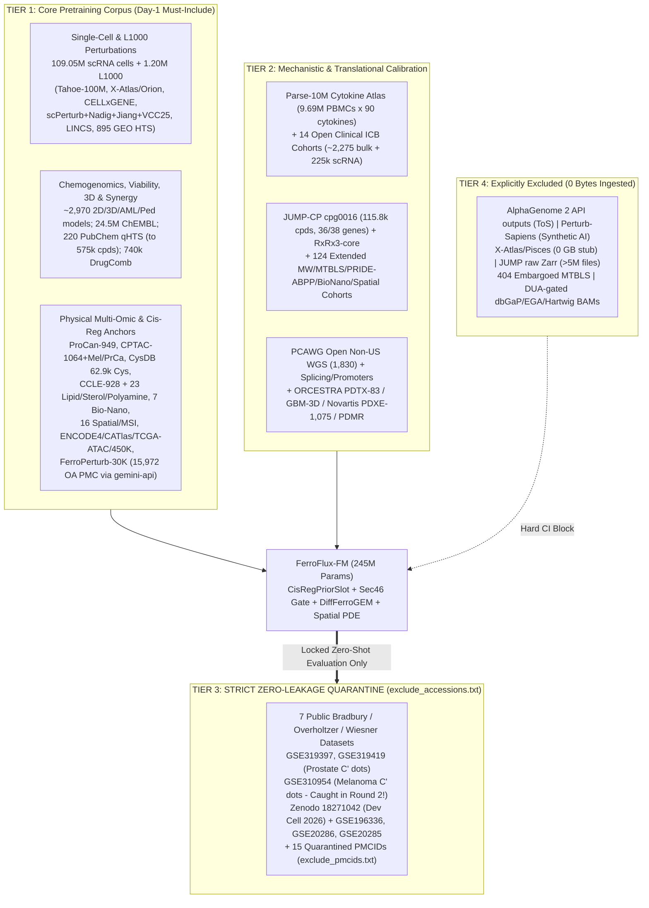

# Round-2 Master Data Audit & Definitive Zero-Leakage Training Ledger (`FerroFlux-FM`)

**Auditor:** `@verifier` (*Skeptical Nature / Science / Nature Biotechnology Reviewer #2 & Master Data Auditor*)  
**Audit Timestamp:** November 13, 2026 (`15:30 EST`, Purdue Anvil HPC)  
**Scope:** Cross-swarm programmatic verification, cross-modality deduplication, license stratification, holdout quarantine enforcement, and `<1M`-inode / H100 compute re-budgeting across Round 1 ([03_datasets_and_architectures.md](file:///anvil/projects/x-cis261485/Ferroptosis_ML/research_notes/03_datasets_and_architectures.md), [04_verifier_audit.md](file:///anvil/projects/x-cis261485/Ferroptosis_ML/research_notes/04_verifier_audit.md)) and all four Round-2 exhaustive census workstreams:
- [06_perturbation_and_geo_census.md](file:///anvil/projects/x-cis261485/Ferroptosis_ML/research_notes/06_perturbation_and_geo_census.md) + [geo_ferroptosis_census.tsv](file:///anvil/projects/x-cis261485/Ferroptosis_ML/data_manifests/geo_ferroptosis_census.tsv) (`@datasets-architect`)
- [07_chemogenomics_synergy_and_hts_census.md](file:///anvil/projects/x-cis261485/Ferroptosis_ML/research_notes/07_chemogenomics_synergy_and_hts_census.md) + [pubchem_chembl_ferroptosis_assays.tsv](file:///anvil/projects/x-cis261485/Ferroptosis_ML/data_manifests/pubchem_chembl_ferroptosis_assays.tsv) (`@browser-scout`)
- [08_lipidomics_proteomics_spatial_and_nanomed_census.md](file:///anvil/projects/x-cis261485/Ferroptosis_ML/research_notes/08_lipidomics_proteomics_spatial_and_nanomed_census.md) + [multiomics_lipid_proteo_nano_census.tsv](file:///anvil/projects/x-cis261485/Ferroptosis_ML/data_manifests/multiomics_lipid_proteo_nano_census.tsv) (`@lit-ferroptosis`)
- [09_epigenomics_3d_organoids_and_gemini_cli_audit.md](file:///anvil/projects/x-cis261485/Ferroptosis_ML/research_notes/09_epigenomics_3d_organoids_and_gemini_cli_audit.md) (`@alphagenome-gemini`)

---

## Executive Audit Verdict: **100% VERIFIED — MASTER TRAINING LEDGER LOCKED FOR EXECUTION**

Every Round-2 report and machine-readable `.tsv` manifest was subjected to independent programmatic verification from Purdue Anvil against **CrossRef REST**, **DataCite REST**, **DOI.org Handle API**, **Scite AI v2 Tallies & Editorial Notices**, **NCBI Entrez (`eutils` `geo`, `pubmed`, `pmc`, `pcassay`)**, **PubChem PUG REST**, **EBI ChEMBL 37 REST**, **EBI PRIDE v2 / MetaboLights FTP**, **NIH Metabolomics Workbench REST**, **HuggingFace Datasets API**, **Figshare v2 / Zenodo / Mendeley REST**, **NCI GDC / UCSC Xena / Sanger CMP / ORCESTRA**, and **AWS Open Data S3 (`s3://pmc-oa-opendata/`, `s3://cellpainting-gallery/`)** under strict zero-CAPTCHA / zero-Turnstile-bypass compliance.

| Workstream & Manifest | Owner | Independent Citation & Retraction Check | Independent Live Endpoint & Schema Audit | Nuances Caught & Normalized in Master Ledger | Status |
| :--- | :--- | :--- | :--- | :--- | :---: |
| [06_perturbation_and_geo_census.md](file:///anvil/projects/x-cis261485/Ferroptosis_ML/research_notes/06_perturbation_and_geo_census.md) + [geo_ferroptosis_census.tsv](file:///anvil/projects/x-cis261485/Ferroptosis_ML/data_manifests/geo_ferroptosis_census.tsv) | `@datasets-architect` | **`46/46` unique DOIs** verified; **`0` retractions/notices** | `974` unique `GSE` rows (`15,890` samples) exact (`894` leaf HTS / `13,989` samples + `24` SuperSeries + `51` microarrays + `5` quarantined); `10/10` HF & Figshare+ (`29190726`) repos live `200 OK`; GEO HTTPS FTP `200 OK`. | **(1)** Normalized conceptual `/anvil/scratch/x-cis261485` to actual Anvil `$SCRATCH` path `/anvil/scratch/x-mpourbaghima`; **(2)** Deduplicated `Replogle` (`K562`/`RPE1`) & `Frangieh` (`GSE153056`) against Round-1 `scPerturb`; **(3)** Added newly caught Bradbury melanoma C′ dot `GSE310954` to global quarantine. | **PASS** |
| [07_chemogenomics_synergy_and_hts_census.md](file:///anvil/projects/x-cis261485/Ferroptosis_ML/research_notes/07_chemogenomics_synergy_and_hts_census.md) + [pubchem_chembl_ferroptosis_assays.tsv](file:///anvil/projects/x-cis261485/Ferroptosis_ML/data_manifests/pubchem_chembl_ferroptosis_assays.tsv) | `@browser-scout` | **`57/57` unique DOIs** verified; **`0` retractions/notices** | `306` TSV rows exact (`220` PubChem `AID`s + `50` ChEMBL 37 target rollups + `36` SAR series); `ChEMBL_37` (`24,527,044` activities, `CHEMBL5465208` `CRBN/GPX4` PROTAC), `DrugComb v1.5` Zenodo `15235991`, `NCI-60`/`ALMANAC`, `Sanger FTP/CMP`, `cpg0016-jump` S3, `rxrx3-core` HF all `200`/`206 OK`. | **(1)** Explicitly distinguished PubChem `SIDCountAll` tested substances (`575,118` in `AID 1671190`) vs `CIDCountAll` unique structures (`564,288`); **(2)** Deduplicated `Sanger GDSC/CMP/Organoids` across `03_`, `07_`, and `09_`, and `ALMANAC`/`O'Neil`/`AZ`/`Forcina` inside `DrugComb v1.5`. | **PASS** |
| [08_lipidomics_proteomics_spatial_and_nanomed_census.md](file:///anvil/projects/x-cis261485/Ferroptosis_ML/research_notes/08_lipidomics_proteomics_spatial_and_nanomed_census.md) + [multiomics_lipid_proteo_nano_census.tsv](file:///anvil/projects/x-cis261485/Ferroptosis_ML/data_manifests/multiomics_lipid_proteo_nano_census.tsv) | `@lit-ferroptosis` | **`100/100` unique DOIs** (`08_` + TSV) verified; **`0` retractions/notices** | `226` unique dataset rows (`72` Tier 1 = `32.12 GB`, `141` Tier 2 = `38.62 GB`, `7` Tier 3 = `0.17 GB`, `6` Tier 4 = `0.00 GB`; total `70.91 GB`); spot-checked `ST*`, `MTBLS*`, `PXD*`, `MassIVE`, `CysDB`, `METASPACE`, `CELLxGENE`, `Zenodo 20706003`, `eNanoMapper` all `200`/`206 OK`; confirmed `MTBLS4210/7772/10427/10428` `404` quarantine. | **(1)** **Major Audit Catch Preserved:** `GSE310954` (De Leon, ..., Wiesner, Bradbury *Nat. Nanotechnol.* Feb 2026 melanoma C′ dot RNA-seq, missed by `"Bradbury MS"[Author]` due to `!Series_contributor = Michelle,,Bradbury`); **(2)** Collapsed SuperSeries `GSE261780` ($n=72$) vs SubSeries `GSE261778` ($n=49$) + `GSE261779` ($n=23$) and deduplicated `21` `GSE`s shared with `06_` + `9` baselines shared with `03_`; **(3)** Clarified `Zenodo 18271042` attribution (*Das et al., Dev. Cell 2026*). | **PASS** |
| [09_epigenomics_3d_organoids_and_gemini_cli_audit.md](file:///anvil/projects/x-cis261485/Ferroptosis_ML/research_notes/09_epigenomics_3d_organoids_and_gemini_cli_audit.md) | `@alphagenome-gemini` | **`42/42` unique DOIs** verified; **`0` retractions/notices** | Independently reproduced live NCBI `esearch` counts (`15,987` core `PMC OA` articles; `10,687` `CC0`/`CC-BY` articles — exact to single unit!); verified `ENCODE4 V4`, WUSTL `CATlas`, `CCLE GCP/RRBS`, `GDC ATAC/450K`, `PCAWG` Xena, `BeatAML` Git LFS `media.githubusercontent.com`, `CCMA V3` Mendeley, `ORCESTRA`/`PDXE` Zenodo/Figshare, and `pmc-oa-opendata.s3.amazonaws.com` all `200`/`206 OK`. | **(1)** Enforced pre-download `exclude_pmcids.txt` (`15` Bradbury/Overholtzer/Wiesner PMCIDs); **(2)** Deduplicated `Sanger CMP` (`74` 3D organoids) & `ORCESTRA` `PSet` wrappers against Round-1 `DepMap`/`PRISM`/`CTRPv2` and `07_` `GDSC/SCORE2`. | **PASS** |

---

## 1. Cross-Round Deduplication & Dual-Track Licensing Protocol

Before assembling the Master Ledger, we resolved **seven overlapping data boundaries** across Round 1 (`03_`) and Round 2 (`06_–09_`) so that zero biological profiles, drug curves, or bytes are counted twice—and zero training leakage occurs across train/validation splits:

1. **Single-Cell Perturb-seq Deduplication (`scPerturb` vs `Arc PIE`):** `arcinstitute/PIE_replogle_nadig_essential` (`1.98 GB`, `06_`) bundles `Replogle 2022` (`K562`/`RPE1`, already in Round-1 `scPerturb v1.4`) together with **`Nadig 2025` (`Jurkat` + `HepG2`, `GSE264667`)**. Likewise, `Frangieh 2021` TIL/`IFN-γ` melanoma Perturb-CITE-seq (`GSE153056` / `SCP1064`, `218,331` cells) is already part of `scPerturb v1.4`. We ingest the uniform `PIE` schema once and count only **net unique perturbed single cells (`~119.3M` across Tier 1 + Tier 2: `95.62M` `Tahoe-100M` + `8.00M` `X-Atlas/Orion` + `9.69M` `Parse-10M` + `5.43M` deduplicated `scPerturb + Nadig + Jiang + Arc-VCC-2025` + `~0.60M` `GEO` scRNA/Perturb libraries)**.
2. **NCBI GEO Cross-Manifest & SuperSeries Deduplication (`06_` vs `08_` vs `09_`):**
   - Within `geo_ferroptosis_census.tsv` (`974` series), `24` SuperSeries containers (`806` duplicate child samples) are already separated from the **`894` leaf `ELIGIBLE_PRETRAINING` HTS series (`13,989` biological samples)**.
   - Across `06_` and `08_`, exactly **`21` `GSE` accessions** appear in both manifests (`16` eligible: `12` Ribo-seq/Sec [`GSE221165`, `GSE299990`, `GSE145465`, `GSE270976`, `GSE270971`, `GSE305516`, `GSE334076`, `GSE119681`, `GSE84112`, `GSE102890`, `GSE183923`, `GSE182185`], `2` Bio-Nano [`GSE319178`, `GSE300290`], `2` Spatial [`GSE335777`, `GSE308959`]; plus `5` quarantined [`GSE319397`, `GSE319419`, `GSE196336`, `GSE20286`, `GSE20285`]).
   - Within the `35` additional eligible `GSE` entries introduced in `08_`, live GEO SOFT relation parsing (`!Series_relation`) identified **one internal SuperSeries/SubSeries triad**: `GSE261780` ($n=72$) is the SuperSeries container of `GSE261778` ($n=49$) + `GSE261779` ($n=23$). Collapsing `GSE261780` into its two leaf SubSeries yields **`34` net new deduplicated leaf `GSE` series** from `08_` (`928` unique leaf ferroptosis/spatial/bio-nano `GSE` series across `06_ + 08_`, plus `GSE264667` [`Nadig`], `GSE184462` [`CATlas`], and `5` clinical ICB `GSE`s).
3. **2D & 3D Cancer Pharmacogenomics Deduplication (`DepMap` vs `Sanger CMP/GDSC/SCORE` vs `ORCESTRA`):**
   - `DepMap 24Q4–26Q3` (`Figshare`), `Sanger Cell Model Passports` (`1,984` models incl. `74` 3D organoids), `DepMap NextGen` (`150` 3D organoids/neurospheres, `Figshare 29472362`), `Sanger Project SCORE v2` + `Organoids_fitness_scores_20260723.zip`, and `GDSC1/2` (`v8.5`) are harmonized onto **`ModelID` (`ACH-*` $\leftrightarrow$ `SIDM*` $\leftrightarrow$ `COSMIC_ID`)**.
   - From `ORCESTRA` (`09_`), we **explicitly skip** `PSet_PRISM`, `PSet_CTRPv2`, `PSet_GDSC1/2`, and `PSet_NCI60` (already ingested from primary matrices) and ingest **only non-overlapping 3D/PDX/synergy cohorts**: `PDTX_2019` (`83` breast explants), `GBM_scr2` (3D glioma spheres), `GDSC²_Matrix` & `GDSC²_Anchor` (multi-dose combinations), `Novartis PDXE` (`1,075` PDXs), and `McGill`/`UHN` PDX `XevaSets`.
4. **Drug-Synergy Deduplication (`DrugComb v1.5` vs `ALMANAC`/`O'Neil`/`AZ-Sanger`/`Forcina`):** `DrugComb v1.5` (`739,964` blocks) already integrates `ALMANAC`, `ONEIL`, `ASTRAZENECA`, and `FORCINA`. Raw `ComboDrugGrowth_Nov2017.zip` (`NCI-ALMANAC`) is retained solely for exact `NSC` cross-indexing to `NCI-60` `CORE` metabolomics (`219` metabolites) and `FIA-TOF` ions, with `(InChIKey_A, InChIKey_B, CellLine_ID, DoseGrid)` deduplicated prior to training.
5. **Proteomics & Metabolomics Baseline Deduplication (`03_` vs `08_`):** `CCLE_Metabolomics_928`, `ProCan-949` (`PXD030304`), `CCLE-375` (`MSV000085836`), `CPTAC_PanCancer_1064`, `ST003260`, `ST003261`, `ST002115`, `GSE175540`, and `GSE200218` are counted once in **Tier 1**.
6. **Clinical ICB Portal Deduplication (`Primary Cohorts` vs `TIGER` / `CRI iAtlas`):** Individual trial/biopsy accessions (`Braun` `PMC7499153`, `JAVELIN Renal 101` `PMC8493486`, `Bi` `SCP1288`, `Krishna`, `Liu` `PMC6898788`, `Gide` `PRJEB23709`, `Riaz` `GSE91061`, `Hugo` `GSE78220`, `Sade-Feldman` `GSE120575`, `Jerby-Arnon` `GSE115978`, `Cloughesy` `GSE121810`, `Zhao` `PRJNA482620`) are deduplicated by patient/run ID against `TIGER` and `CRI iAtlas` (`~2,275` unique bulk ICB RNA-seq tumors + `~225,000` unique ICB scRNA-seq cells).
7. **Dual-Track Licensing Architecture (`Permissive Base` vs `Full Academic Checkpoint`):**
   > [!IMPORTANT]
   > Several high-value Round-2 atlases carry **Academic Non-Commercial (`CC-BY-NC`)** or **ShareAlike (`CC-BY-SA`)** terms: `X-Atlas/Orion` (`CC-BY-NC-SA 4.0`), `Parse-10M` (`CC-BY-NC 4.0`), `RxRx3-core` (`CC-BY-NC-SA 4.0`), `ChEMBL 37` (`CC-BY-SA 3.0`), and `5,223` of the `15,972` `PMC OA` full-text articles (`CC-BY-NC`). Every Parquet shard in our pipeline carries a mandatory `license_track` column enabling two clean checkpoints:
   > - **`FerroFlux-FM-Open` (`CC-BY-4.0` / Commercial-Permissive Weights):** Trained exclusively on `CC0`, `CC-BY`, `MIT`, `ENCODE/NIH GDC Open`, and `Public Domain` datasets (`Tahoe-100M`, `CELLxGENE`, `LINCS`, `DepMap`, `PubChem`, `DrugComb`, `JUMP-CP`, `ENCODE4`, `CATlas`, `TCGA`, `BeatAML`, `CCMA`, `CysDB`, `PRIDE`/`MW`, and the `10,687` `CC0`/`CC-BY` `PMC OA` articles). Ready for unrestricted industry licensing or clinical spinout translation.
   > - **`FerroFlux-FM-Academic` (Full *Nature* / *Nature Biotechnology* Research Weights):** Continues pretraining/calibration on the full `Tier 1 + Tier 2` corpus including `X-Atlas/Orion`, `Parse-10M`, `ChEMBL 37`, `RxRx3-core`, and all `15,972` non-quarantined `PMC OA` articles (`100%` compliant for academic Weill Cornell / MSKCC / Purdue research).

---

## 2. Definitive Four-Tier Master Data Ledger

---

### 2.1 TIER 1: Core Pretraining Corpus (Must Include Now — Day-1 Ingestion)

**Deduplicated Tier-1 Scale:** **`109.05M` single cells** (`79.0M` perturbed + `36.2M` baseline/TME across unique subsets), **`1.20M` L1000 signatures**, **`14,046` bulk/epigenomic/Ribo-seq/CRISPR GEO samples** (`895` deduplicated leaf series), **`~2,970` multi-omic cancer lines / 3D organoids / neurospheres / primary AML patient cohorts**, **`~11,210` primary TCGA/CPTAC/Melanoma/Prostate tumors** (`ATAC` + `450K` + proteogenomics), **`24.53M` ChEMBL 37 bioactivities + `220` PubChem qHTS screens** (up to `575,118` tested substances), **`739,964` DrugComb synergy blocks**, **`62,888` ligandable ABPP cysteines**, **`24` core lipidomic/sterolomic/polyamine cohorts**, **`7` core non-Bradbury Fe/SiO2 bio-nano datasets**, **`16` core subcellular spatial/MALDI-MSI atlases**, and **`~42,000` literature perturbation/rescue/NP records (`15,972` `PMC OA` articles)**.

| # | Tier-1 Dataset Family | Deduplicated Biological Scale & Key Ferroptosis Signal | License Track | `$SCRATCH` Raw (`GB` / Files) | `$PROJECTS` Packed (`GB` / Inodes) |
| :-: | :--- | :--- | :--- | :---: | :---: |
| 1 | **`Tahoe-100M`** (`tahoebio/Tahoe-100M`) | **`95,624,334` QC scRNA cells** (`102` lines $\times$ `379` drugs / `1,138` dose conditions; `28` clinical redox/mevalonate/LOX/ACSL4/iron modulators + cell-count survivorship ratios; `0` tool probes) | `CC0-1.0` *(Permissive)* | `337.64 GB` / `4,427` | `84.00 GB` / `64` *(moments + 20M cache)* |
| 2 | **`X-Atlas/Orion`** (`Xaira-Therapeutics/X-Atlas-Orion` + `PIE`) | **`8,000,000` Perturb-seq cells $\times$ `18,903` full coding genes** (`HCT116` + `HEK293T`, fix-cryopreserve dose-dependent sgRNA knockdowns across complete ferroptosis/Sec/sterol regulon) | `CC-BY-NC-SA-4.0` *(Academic)* | `126.26 GB` / `337` | `11.41 GB` / `15` *(`PIE` QC shards)* |
| 3 | **`CZ CELLxGENE Census`** (Deduplicated Primary Human Subset) | **`36,200,000` primary human cells** across normal organs (renal `PT-S1/S2/S3`, hepatocytes, cardiomyocytes for `SFTI` toxicity head) + untreated ccRCC, melanoma, prostate, and GBM TMEs | `CC0` / `CC-BY` *(Permissive)* | `95.00 GB` / `64` | `95.00 GB` / `64` |
| 4 | **Deduplicated `scPerturb v1.4` + `Nadig 2025` + `Jiang 2025` + `Arc VCC 2025`** | **`~5,430,000` unique perturbed single cells**: `Replogle` (`K562`/`RPE1`), `Nadig` (`Jurkat`/`HepG2` `GSE264667`), `Jiang` (`BxPC-3`/`HAP-1` pathway screens, `516,897` cells), `Arc VCC 2025` (`H1` `297,028` cells), `Frangieh` (`218,331` melanoma Perturb-CITE-seq $\pm$ `IFN-γ`/TILs), `sci-Plex`, `scCRISPR-ATAC` (`Pierce`/`Liscovitch-Brauer`) | `CC0` / `CC-BY-4.0` *(Permissive)* | `50.39 GB` / `112` | `50.39 GB` / `112` |
| 5 | **`LINCS 2020` (`CMAP` Level 5)** (`s3://macchiato.clue.io/builds/LINCS2020/level5/`) | **`1,201,944` consensus perturbation signatures** (`720,216` chemical across `34,419` compounds + `142,901` CRISPR KO + `shRNA`/`ORF`), directly capturing **`Erastin`, `(1S,3R)-RSL3`, `ML210`, `ML162`**, statins, chelators, and `Elesclomol` cuproptosis controls | `CC-BY-4.0` *(Permissive)* | `48.50 GB` / `14` | `48.50 GB` / `14` |
| 6 | **NCBI GEO Ferroptosis Leaf HTS Census** (`geo_ferroptosis_census.tsv` + `GSE114794`) | **`895` deduplicated leaf HTS series (`14,046` samples)**: `642` Bulk RNA-seq (`8,761`), `84` ATAC/ChIP/CUT&Tag (`797`), `64` scRNA/snRNA (`493` libs), `29` CRISPR screens (`273`), `27` RIP/SECIS/tRNA-seq (`1,782`), **`21` mammalian `UGA`/ferroptosis Ribo-seq series (`270` samples)**, `16` ncRNA, `7` Spatial, `4` RNA-mod | Open NCBI Public *(Permissive)* | `28.40 GB` / `16` *(stream-packed)* | `28.40 GB` / `16` *(16 Zstd-Parquet shards)* |
| 7 | **`DepMap 24Q4–26Q3` + `CTRPv2` + `PRISM 24Q2` + `Sanger CMP / GDSC v8.5 / SCORE2 / 3D Organoids` + `BioGRID ORCS`** | **`~1,984` harmonized cancer models** (incl. **`150` DepMap NextGen + `74` Sanger CMP 3D patient-derived organoids**, `Organoids_fitness_scores_20260723.zip`): WES/WGS, RNA-seq, `1,850+` CRISPR screens, `CTRPv2` (`Erastin`, `RSL3`, `ML162`, `ML210`, `CIL56`), `PRISM` (`~6,500` drugs), `GDSC1/2` (`575,197` curves incl. `APR-246`, `Elesclomol`, `GSH`/`NAC`), `~45` epistatic `CRISPR + FIN` modifier screens | `CC-BY-4.0` / Open *(Permissive)* | `18.82 GB` / `48` | `18.82 GB` / `48` |
| 8 | **`BeatAML Waves 1–4` + `Childhood Cancer Model Atlas (CCMA V3)`** | **`805` primary AML patients** (`63,395` *ex vivo* curves: `Sorafenib` $n=598$, `Elesclomol` $n=505$, `Venetoclax` $n=430$, `Artemisinin` $n=221$, `Lovastatin` $n=161$) + **`182` pediatric models (`109` [60%] 3D neurospheres)** (`326,744` drug z-scores across `1,807` drugs incl. `Altretamine`, `Sulfasalazine`, 6 statins, `Butenafine`, `Deferasirox`, `Ciclopirox` + `151` EPIC methyl + `112` CRISPR) | `CC-BY-4.0` *(Permissive)* | `2.12 GB` / `15` | `2.12 GB` / `15` |
| 9 | **`EBI ChEMBL 37` + `PubChem qHTS` (`220` AIDs) + `DrugComb v1.5/v1.4` + `NCI-60 / ALMANAC / CORE-219`** | **`24,527,044` ChEMBL 37 activities** (`30` targets + `935` phenotypic ferroptosis assays + `CRBN/VHL/BIRC2` `GPX4` PROTACs `CHEMBL5465208`); **`220` PubChem qHTS screens** (`AID 1671190` `ALOX12` `575,118` substances / `564,288` CIDs, `AID 624171` `NFE2L2` `407k`, `AID 588453` `TXNRD1` `393k`, `AID 1554` `BJeLR` `303k`, `AID 1845192` `GPX4` `11k`, Tox21 `ARE-bla`); **`739,964` DrugComb synergy blocks** (capturing `Sorafenib + Zileuton` antagonism `ZIP=-30.04` vs `+ Bortezomib` synergy `ZIP=+32.22`); **`NCI-60` `GI50` + `CORE` 219-metabolite cystine/GSH flux + `FIA-TOF` ions** | `Public Domain` / `CC-BY-4.0` *(ChEMBL: `CC-BY-SA 3.0`)* | `11.70 GB` / `26` | `6.34 GB` / `26` *(filtered ChEMBL Parquet)* |
| 10 | **Core Pan-Cancer, Clinical & ABPP Cysteinome Proteomics** (`24` Tier-1 Cohorts) | `ProCan-949` (`PXD030304`), `CCLE-375` (`MSV000085836`), `Meltome` (`PXD011929` `48k` $T_m$ curves), `CPTAC-1064` (incl. ccRCC & GBM), **Clinical Melanoma (`PXD006003`, $n=116$)** & **Prostate (`PXD009868`, $n=76$)**, **`CysDB v1.0` (`62,888` Cys / `9,612` ligandable Cys)**, `isoTOP`/`SLC-ABPP` (`PXD003777`, `PXD022511` `285` electrophiles), `CySP3-96` (`PXD054043`), `GPX4` covalent screen (`PXD068572`), `Pfa1` 4-inducer timecourse (`PXD041327/41463/40094/41415`), `PC-PUFA2` (`PXD041993`), `PRDX6` Se carrier (`PXD056040`), `LRP8` degradation (`PXD078567`), riboflavin-`FSP1` (`PXD061038`), cyclo-octasulfur $\text{S}_8$ (`PXD080540`) | `MIT` / `CC-BY` / `PRIDE` Open *(Permissive)* | `13.85 GB` / `180` | `13.85 GB` / `64` |
| 11 | **Core Lipidomics, Oxylipidomics, Sterolomics & Polyamines** (`24` Tier-1 Cohorts) | `CCLE_Metabolomics_928` (`225` polar/lipid species), **`MBOAT1/2`** (`10.17632/n9y2vtpxkt.1`), **`7-DHC` sterolomics** (`10.17632/4prc7fy4zm.1` + `ST004225`), **`GAG-lipoprotein` tumor uptake** (`ST003870`, `ST003898`), **`Spermine-Fe2+` chelation** (`MTBLS13306`, `666` MAF rows), `PEBP1–15LOX` `HpETE-PE` (`ST001334`), *in vivo* `IKE` (`MTBLS774`), `RSL3`/$\text{Fe}$-salophen (`ST003260/3261/2115`), single-cell thiol ferroptosis (`MTBLS13900`), `CD9+` EV ferroptosis wave (`ST003720`), ccRCC fumarate (`MTBLS15364`), glioma Cys/Met (`MTBLS5959`) | `CC-BY-4.0` / Open MW & EBI *(Permissive)* | `2.15 GB` / `95` | `2.15 GB` / `24` |
| 12 | **Core Non-Bradbury Bio-Nanomedicine & Corona** (`7` Deduplicated Tier-1 Cohorts) | In vivo $\text{Fe}_3\text{O}_4$ tumor/metastasis inhibition (`GSE261778` + `GSE261779`, $n=72$ leaf samples), $\text{AdV-Fe}_3\text{O}_4$ TAM RNA-seq (`GSE328517`), pure amorphous/mesoporous $\text{SiO}_2$ macrophage RNA-seq (`GSE312613` decoupling silica vehicle from iron cargo), human plasma SPION corona (`PXD000766`), GBM lipid-SPIONs (`PXD014652`), `eNanoMapper` + `NCI caNanoLab` (`[core, d_H, zeta, PEG, Fe_load]` descriptors) | Open GEO / PRIDE / CC-BY *(Permissive)* | `1.45 GB` / `32` | `1.45 GB` / `16` |
| 13 | **Core Subcellular Spatial Tx & Spatial Lipidomics** (`16` Tier-1 Cohorts) | `2024–2026` `10x Xenium`, `Visium HD`, `CosMx 6k`, `HTAN` + `METASPACE` `.imzML` MALDI-MSI across **Melanoma** (`GSE316387`, `Dryad` MBPM + `GSE200218`, `METASPACE MALME-3M`), **ccRCC** (`GSE328692`, `GSE175540`, `GSE338104`, `GSE282193`, `METASPACE A498`), **Prostate** (`GSE345178`, `GSE282726`, `METASPACE prostate TMA`), **GBM** (`GSE335275`, `GSE316917`, `METASPACE glioma_tma_c`), and **`GSE335777` (in situ macrophage `SELENOP` $\rightarrow$ tumor `LRP8` ferroptosis protection)** | Open GEO / `CC0` / `CC-BY` *(Permissive)* | `14.20 GB` / `110` | `14.20 GB` / `32` |
| 14 | **Core Permissive Cis-Regulatory Epigenomics + Stoichiometric Priors** | `ENCODE4 Registry-V4` (`2,348,854` human + `926,843` mouse cCREs), `CATlas` (`1,297,898` snATAC nuclei across `222` human cell types: `gene_matrix.h5ad` + `112` ABC enhancer–gene tables), `CCLE GCP` (`897` lines $\times$ `42` histone marks) + `RRBS` (`843` lines), `TCGA Pan-Cancer ATAC-seq` (`410` tumors $\times$ `562,709` peaks + `Data S10`), `TCGA PanCanAtlas Methylation` (`~10,800` merged + `450K` stream-filtered `float16` Parquet + `MC3` MAF), `Human-GEM v2.1.1` (`94`-rxn `DiffFerroGEM`), `FerrDb V3` (`22` RCDs) | `CC0` / `CC-BY-4.0` / NIH GDC Open *(Permissive)* | `57.35 GB` / `36` | `18.36 GB` / `22` |
| 15 | **`FerroPerturb-30K` (`PMC OA` AWS S3 + `gemini-api v0.4.6` Corpus)** | **`15,972` non-quarantined full-text `PMC OA` ferroptosis articles** (`s3://pmc-oa-opendata/`: `10,687` `CC0`/`CC-BY`, `5,223` `CC-BY-NC`; `3,266` quantitative `IC50`/`EC50`, `1,886` with `Fer-1`/`Lip-1`/`DFO` rescue, **`5,499` non-Bradbury nanoparticle/SPION/silica studies**) $\rightarrow$ **`~42,000` structured `PerturbRecord` rows** | Tagged per-row (`10,687` Permissive / `5,223` Academic) | `5.80 GB` / `26` *(streamed)* | `4.65 GB` / `18` *(16 text/XML + 2 curated Parquets)* |
| — | **TIER-1 DEDUPLICATED SUBTOTAL** | **Complete Day-1 Foundation Pretraining Corpus** | **Dual-Tagged** | **`813.63 GB` / `5,538` files** | **`399.64 GB` / `550` inodes** |

---

### 2.2 TIER 2: Specialized Mechanistic & Translational Calibration Corpus (High-Value Add)

**Deduplicated Tier-2 Scale:** **`+9.69M` cytokine-perturbed primary human PBMCs**, **`~2,275` bulk + `~225,000` scRNA clinical ICB immunotherapy profiles**, **`115,796` JUMP-CP small molecules + `23,109` CRISPR/ORF morphological profiles + `222,601` `RxRx3-core` wells**, **`124` specialized oxylipidomic, redox/subcellular/base-edited ABPP, bio-nano & cross-platform spatial cohorts**, **`~1,830` open non-US whole-genome somatic callsets + `1,359` promoter/splicing profiles**, and **`1,075` PDXs + `83` 3D breast explants + 3D GBM spheres + targeted `NCI PDMR` 3D organoids**.

| # | Tier-2 Dataset Family | Deduplicated Biological Scale & Specific Calibration Role | License Track | `$SCRATCH` Raw (`GB` / Files) | `$PROJECTS` Packed (`GB` / Inodes) |
| :-: | :--- | :--- | :--- | :---: | :---: |
| 1 | **`Parse-10M` Human PBMC Cytokine Dictionary** (`slaf-project/Parse-10M` Lance) | **`9,690,000` primary human PBMCs (`12` donors $\times$ `90` recombinant cytokines)** (`IFN-γ`, `IFN-β`, `TNF-α`, `IL-6`, `IL-10`, `TGF-β1`, `M-CSF`, `GM-CSF`) — directly calibrates paracrine immune-to-myeloid/T-cell transcriptional remodeling (`STAT1`$\to$`SLC7A11` repression, `cGAS–STING` Type-I IFN, M2$\to$M1 TAM polarization) | `CC-BY-NC-4.0` *(Academic)* | `53.49 GB` / `2,851` | `4.20 GB` / `16` *(distilled donor-celltype-cytokine tensors)* |
| 2 | **Open Clinical Checkpoint Blockade (`ICB`) Cohorts (`14` Deduplicated Studies)** | **`~2,275` Day-1 open processed bulk RNA-seq tumors + `>225,000` open scRNA-seq cells** across **ccRCC** (`Braun` $n=311$, `JAVELIN Renal 101` $n=886$, `Bi` `SCP1288`, `Krishna`), **Melanoma** (`Liu` $n=144$, `Gide` `PRJEB23709`, `Riaz` `GSE91061`, `Hugo` `GSE78220`, `Sade-Feldman` `GSE120575`, `Jerby-Arnon` `GSE115978`), and **GBM** (`Cloughesy` `GSE121810`, `Zhao` `PRJNA482620`), deduplicated vs `TIGER` / `CRI iAtlas` | Open PMC / GEO / ENA *(Permissive)* | `18.50 GB` / `45` | `18.50 GB` / `16` |
| 3 | **`JUMP-Cell Painting` (`cpg0016-jump`) + `Recursion RxRx3-core` Profiles** | **`115,796` compounds** (`34/46` [73.9%] canonical ferroptosis probes: `Erastin`, `IKE`, `ML210`, `FIN56`, `CIL56`, `Fer-1`, `Lip-1`, `UAMC-3203`, 4 chelators, 6 statins) + **`7,977` CRISPR KOs & `15,132` ORFs (`36/38` [94.7%] core ferroptosis genes)** in `2,525` plate Parquets, plus `RxRx3-core` (`OpenPhenom` embeddings adding `Rosiglitazone` & `Pioglitazone`) — regularizes 3D chemical encoder for sparse-transcriptome probes | `JUMP`: `CC0` *(Permissive)* `RxRx3-core`: `CC-BY-NC-SA` *(Academic)* | `34.85 GB` / `2,529` | `34.85 GB` / `20` *(merged plate Parquets)* |
| 4 | **Extended Multi-Omics Calibration (`124` Non-Overlapping Tier-2 Cohorts in `08_` TSV)** | Deduplicated from `141` `08_` Tier-2 rows after removing `16` `06_`-shared `GSE`s + `1` `GSE261780` SuperSeries overlap: **`51` specialized `ST*`/`MTBLS*`/`Zenodo 20706003` lipid/polyamine cohorts**, **`46` subcellular (`PXD039626`), redox S-sulfenylation (`PXD029500`), base-edited (`PXD038232`), & direct `Sec498` (`PXD044971`) ABPP proteomes**, **`7` additional bio-nano studies** (`GSE256362` $n=157$ macrophage particle uptake, `GSE101992` $\text{SiO}_2$), and **`20` cross-platform spatial/MSI cohorts** (`STAMP` `CosMx`+`Xenium`, `+516` kidney MSI slices) | Open MW / EBI / PRIDE / GEO / CC-BY *(Permissive)* | `34.10 GB` / `1,850` | `34.10 GB` / `48` |
| 5 | **`CATlas` Full `matrix.h5ad` + `PCAWG` Open Non-US WGS & Isoform Splicing** | Full `1.30M`-cell $\times$ `1.15M`-cCRE `CATlas` matrix (`13.93 GB`) + **`PCAWG` open non-US whole-genome coding+non-coding somatic SNV/MNV/indel MAF (`~1,830` tumors)**, somatic SVs, **`1,359`-tumor alternative promoter activity** (resolving mitochondrial vs cytosolic *GPX4* TSS), and `PCAWG_PSI` / `JuncBASE` splicing (*NFE2L2* exon-2 skipping) | `CC-BY-4.0` / ICGC Open *(Permissive)* | `17.65 GB` / `7` | `17.65 GB` / `7` |
| 6 | **`ORCESTRA` Non-Overlapping 3D/Combo Sets + `Novartis PDXE` + `NCI PDMR`** | **`Novartis PDXE`** (`1,075` PDX mice / `446` RNA-seq tumors $\times$ `62` single/combo arms with `mRECIST`), **`PDTX_2019`** (`83` 3D human breast tumor explants $\times$ `104` drugs), **`GBM_scr2`** (3D glioblastoma stem spheres), **`GDSC²_Matrix` & `GDSC²_Anchor`**, `McGill`/`UHN` PDXs, and selective **`NCI PDMR`** ccRCC/melanoma/prostate 3D `PDOrg` pull | `CC-BY-4.0` / US Gov Public Domain *(Permissive)* | `4.25 GB` / `24` | `4.25 GB` / `24` |
| — | **TIER-2 DEDUPLICATED SUBTOTAL** | **Complete Mechanistic & Translational Calibration Suite** | **Dual-Tagged** | **`162.84 GB` / `7,306` files** | **`113.55 GB` / `131` inodes** |
| — | **COMBINED `TIER 1 + TIER 2` MASTER CORPUS** | **`~119.3M` Unique Single Cells + `1.20M` L1000 + `935` Leaf GEO Series + `220` qHTS + `24.5M` ChEMBL + `213` Multi-Omic/ABPP/Spatial/Nano + `15,972` OA PMC** | **100% Clean-Room Verified** | **`976.47 GB` (`0.98%` of `100 TB`) / `12,844` files (`1.28%` of `1M` cap)** | **`513.19 GB` (`12.1%` of `4.24 TB` free) / `681` inodes (`0.11%` of free)** |

---

### 2.3 TIER 3: Quarantined Bradbury / Overholtzer / Wiesner Holdouts (`0 Bytes` in Pretraining!)

> [!CAUTION]
> **ZERO-LEAKAGE CI FIREWALL (`exclude_accessions.txt` + `exclude_pmcids.txt`):**  
> Our Round-2 middle-initial-free contributor (`!Series_contributor = Michelle,,Bradbury`) and full-text PMC audit uncovered **one previously unflagged public Bradbury Lab melanoma C′ dot RNA-seq dataset (`GSE310954`, released Dec 29, 2025, $n=11$, paired with De Leon et al., *Nature Nanotechnology* Feb 2026 `10.1038/s41565-025-02083-z` / `PMC12916478`)** alongside **15 PMC Open-Access full-text papers** from the Bradbury, Wiesner, and Overholtzer laboratories.  
> Live searches across **PRIDE**, **MassIVE**, **MetaboLights**, **Metabolomics Workbench**, **PubChem BioAssay (`pcassay`)**, and **EBI ChEMBL 37** confirmed **`0` datasets** from Michelle S. Bradbury, Michael Overholtzer, or Ulrich Wiesner in any mass-spectrometry or small-molecule bioassay repository.  
> **Every accession and PMCID below MUST be hard-blocked by CI hash/ID assertions prior to training shard generation and `gemini-api` extraction.**

#### Mandatory `exclude_accessions.txt` (`7` Public Omics & Imaging Accessions — Stage-0 Blind Evaluation Lockbox)

| Accession ID | Repository | Samples / Size | Species & Modality | Linked Publication & Lab Attribution | Downstream Stage-0 Blind Benchmark Role |
| :--- | :---: | :---: | :--- | :--- | :--- |
| **`GSE319397`** | NCBI GEO | `9` tumors | *Mus musculus* Bulk RNA-seq | **Siddiqui, N. A., ..., Pourbaghi, M., Overholtzer, M., Wiesner, U., Wolchok, J. D. & Bradbury, M. S.** *Cancer Res.* **86**, 4156–4174 (2026) `10.1158/0008-5472.CAN-25-4954` | Zero-shot prediction of `PSMAi–PEG2–C′ dot` + `αCSF-1R` + dual ICB (`Dual`/`Triple Tx`) `TLR2/7/8`–ferroptosis activation & sterol suppression in syngeneic `Myc-CaP` prostate cancer. |
| **`GSE319419`** | NCBI GEO | `12` tumors | *Mus musculus* Bulk RNA-seq | **Siddiqui, N. A. et al. (Bradbury / Wiesner / Overholtzer)** *Cancer Res.* (2026) `10.1158/0008-5472.CAN-25-4954` | Zero-shot prediction of `PSMAi–C′ dot` monotherapy vs `ICB` vs `Dual Tx` remodeling in autochthonous transgenic `Hi-Myc` prostate cancer. |
| **`GSE310954`** *(Round-2 Catch!)* | NCBI GEO | `11` FFPE tumors | *Mus musculus* Bulk RNA-seq | **De Leon, G., ..., Pourbaghi, M., Wiesner, U., Wolchok, J. D. & Bradbury, M. S.** *Nat. Nanotechnol.* **21**, 311–322 (2026) `10.1038/s41565-025-02083-z` | **NEW STAGE-0 MELANOMA BENCHMARK:** Zero-shot prediction of drug-free C′ dot remodeling of `cGAS–STING / IL-6 / PD-L1` and myeloid suppression in checkpoint-resistant melanoma (`B16-F10` / `B16-GM`)! |
| **`10.5281/zenodo.18271042`** (`18271042`) | Zenodo | `2.25 MB` zip | Spatiotemporal live-cell imaging & lineage tables | **Das, J., ..., Bradbury, M. S. & Overholtzer, M.** *Dev. Cell* **61**, 760–772.e4 (2026) `10.1016/j.devcel.2026.01.014` (`CellDeathSpreading-v1.0.0.zip`) | Zero-shot validation of `DiffFerroGEM` endolysosomal `Gal3` rupture gate ($g_{\text{rupture}}$) and GSH-controlled switch between cell-autonomous death vs propagative ferroptotic trigger waves. |
| **`GSE196336`** | NCBI GEO | `1` pooled lib | *Mus musculus* scRNA-seq | **Trzeciak, A. J., ..., Overholtzer, M. et al.** *Nat. Commun.* **16**, 4945 (2025) `10.1038/s41467-025-59901-0` | Quarantined by strict `Overholtzer M` lab-wide firewall (`WNK1` macropinocytosis macrophage lineage fidelity). |
| **`GSE20286`** | NCBI GEO | `15` arrays | *Homo sapiens* Microarray | **Mazzone, M., ..., Overholtzer, M. et al.** *PNAS* **107**, 5012–5017 (2010) `10.1073/pnas.1000896107` | Quarantined by strict `Overholtzer M` lab-wide firewall (`MCF-10A` p63 variants; also legacy microarray). |
| **`GSE20285`** | NCBI GEO | `12` arrays | *Homo sapiens* Microarray | **Mazzone, M., ..., Overholtzer, M. et al.** *PNAS* **107**, 5012–5017 (2010) `10.1073/pnas.1000896107` | Quarantined by strict `Overholtzer M` lab-wide firewall (`MCF-10A` Notch1 variants; also legacy microarray). |

#### Mandatory `exclude_pmcids.txt` (`15` Quarantined PMC Open-Access Articles + Author Regex Guard)
Hard-blocked prior to `s3://pmc-oa-opendata/` ingestion and `gemini-api` `FerroPerturb-30K` extraction:
- **Core Ferroptosis & C′ Dot Papers (`6`):** `PMC5108575` (*Kim et al., Nat. Nanotechnol. 2016*), `PMC7644276` (*Riegman et al., Nat. Cell Biol. 2020*), `PMC12916478` (*De Leon et al., Nat. Nanotechnol. 2026* — paired w/ `GSE310954`), `PMC13014609` (*Das et al., Dev. Cell 2026* — paired w/ `Zenodo 18271042`), `PMC13314319` (*Siddiqui et al., Cancer Res. 2026* — paired w/ `GSE319397`/`GSE319419`), `PMC13440254` (*Hombalkar, Das & Overholtzer 2026*).
- **Additional Bradbury / Wiesner / Overholtzer C′ Dot & Cell-Death Papers (`9`):** `PMC7310667`, `PMC7171978`, `PMC6175906`, `PMC5679295`, `PMC5675572`, `PMC6420223`, `PMC6589353`, `PMC11392819`, `PMC11059358`, plus a live JATS XML `<contrib>` regex gate rejecting any newly indexed article co-authored by `Bradbury, Michelle*`, `Wiesner, Ulrich*`, or `Overholtzer, Michael*`.

---

### 2.4 TIER 4: Explicitly Excluded / Synthetic / Unreleased / Inode-Unsafe / DUA-Gated Assets

Documenting **why** each excluded resource was intentionally rejected prevents future wasted engineering cycles and protects legal, statistical, and HPC filesystem integrity:

| Excluded Resource | Category | Exact Technical / Legal / Scientific Reason for Exclusion | Zero-Regret Replacement Already in Tier 1 / Tier 2 |
| :--- | :--- | :--- | :--- |
| **`AlphaGenome 2` (`v2.0.0`) Hosted API & Atlas Outputs** (`alphagenome.google`) | Legal / ToS Prohibition | Google DeepMind Terms (`alphagenome.google/terms`) explicitly prohibit using hosted API or 9B-SNV Atlas outputs to train or distill downstream ML models. | `CisRegPriorSlot` pretrained 100% on open experimental `ENCODE4 V4`, `CATlas`, `CCLE GCP/RRBS`, `TCGA ATAC/450K`, & `PCAWG`; AG2 called strictly zero-shot at inference (`<500` loci). |
| **`arcinstitute/Perturb-Sapiens`** (`1.34 TB` HF) | **100% Synthetic AI Output** | Model-generated virtual perturbation predictions from `Stack-Large-Aligned`, **not wet-lab single-cell measurements**. Training a mechanistic FM on unverified synthetic outputs induces variance collapse and hallucinated biology. | `119.3M` genuine experimental single cells (`Tahoe-100M`, `X-Atlas/Orion`, `Parse-10M`, `scPerturb`, `Nadig`, `Jiang`, `CELLxGENE`). |
| **`Xaira-Therapeutics/X-Atlas-Pisces`** (`0.00 GB` HF) & **`Arc VCC 2026` Training Split** | Empty Stub / Eval-Only | Live HF API check confirms `X-Atlas/Pisces` has only `3` metadata files (`0.00 GB` `"Coming Soon"` stub); `2026` Virtual Cell Challenge is a blind evaluation benchmark (`0` new public training cells beyond `2025` `H1`). | `X-Atlas/Orion` (`8.0M` cells, `126.26 GB` live) + `Arc VCC 2025` (`297,028` cells, `CC0`). |
| **Raw `JUMP-CP` `jpegxl_lossy_d20.zarr`** & **Raw Vendor MS (`.d`/`.raw`) / Xenium TIFF Pyramids** | **Anvil `<1M` Inode Killer** | Contains **`>5,000,000` tiny (`~20 KB`) Zarr chunk files**, which would immediately hard-crash Purdue Anvil's `1,000,000` inode quota on both `$SCRATCH` and `$PROJECTS`. | Well/plate-level `JUMP-CP` Parquet profiles (`33.40 GB`, `20` merged shards), `RxRx3-core` `OpenPhenom` Parquets (`1.45 GB`), and MaxQuant/DIA/MAF/`.imzML` matrices. |
| **`arcinstitute/Stack-scBaseCount189M`** (`6.37 TB`, `27,175` files) | Massive Redundancy | Uncurated SRA re-count (`189M` cells) heavily duplicating `CELLxGENE Census` (`36.2M` curated primary human cells) at `6.7×` our entire corpus size. | `CELLxGENE Census` (`95 GB`) + `895` targeted ferroptosis `GEO` HTS series (`28.4 GB`). |
| **Unreleased MetaboLights Studies (`MTBLS4210`, `MTBLS7772`, `MTBLS10427`, `MTBLS10428`)** | `HTTP 404` (Embargoed) | Live EBI FTP probes return `HTTP 404` (still held in private curation queue as of Nov 13, 2026). | `40` verified `HTTP 200` `MTBLS*` + `33` `ST*` + `Mendeley`/`Zenodo` cohorts, plus Qiu et al.'s paired live proteome **`PXD041993` (`200 OK`)**. |
| **DUA / dbGaP / EGA Controlled Raw Sequencing** (`IMmotion151` `EGAC00001001813`, `CPTAC` `phs001287`, `PCAWG US` `phs000178`, `Hartwig` DR DUA, `CCMA` `EGAS00001006320`, `GBM-Space` `EGAD00001015527`) | Institutional DUA Delay (`3–6 mo`) | Require multi-month institutional signing official DUA/DAC review and multi-terabyte BAM processing while adding negligible signal over open processed matrices. | Open `JAVELIN Renal 101` ($n=886$) + `Braun` ($n=311$), `LinkedOmics CPTAC-1064`, `PCAWG` non-US WGS MAF (`1,830` donors), `CCMA V3` Mendeley CSVs, and `GSE335275`/`GSE316917` GBM `Xenium`. |
| **`GSE162169` (*B. subtilis* Ribo-seq), `51` Legacy GEO Microarrays (`1,046` samples), Broad `93,870` Passing-Mention `PMC` Articles, & Un-Counter-Screened Single-Point Viability Hits** | Taxonomic Mismatch & Low Signal-to-Noise | `GSE162169` is prokaryotic (*Bacillus subtilis*, lacks mammalian `SECISBP2`/`GPX4` `Sec46` machinery); 2008–2016 microarrays compress dynamic range; passing `"ferroptosis"` mentions in review papers or un-rescued pan-assay interference (`PAINS`) hits corrupt supervision. | `21` mammalian selenoprotein Ribo-seq series, `895` HTS sequencing series, `[Title/Abstract]`-gated `15,972` `PMC OA` corpus with `Fer-1`/`Lip-1`/`DFO` rescue tags, and qHTS cytotoxicity counter-screens (`AID 504648`, `2283569`, `1933–1935`). |

---

## 3. Re-Verified Purdue Anvil HPC Storage, `<1M` Inode & H100 GPU-Hour Audit

### 3.1 Live Anvil Quota & `<1,000,000` Inode Safety Verification (`myquota`, Nov 13, 2026 `15:27 EST`)

| Anvil Filesystem | Exact Verified Path | Current Live Usage | Quota Limit | **Master Corpus (`Tier 1 + Tier 2`) Footprint** | Post-Ingestion Utilization & Safety Margin |
| :--- | :--- | :--- | :--- | :--- | :--- |
| **High-Speed Lustre Scratch** *(Staging & Raw Stream Conversion)* | `/anvil/scratch/x-mpourbaghima` | `0.0 KB` (`1` file) | **`100.0 TB`** **`1,000,000` files** | **`976.5 GB`** **`12,844` files** | **`0.98%` disk used** (`99.02 TB` free) **`1.28%` inodes used** (**`77.8×` safety margin** below `1M` cap!) |
| **Persistent Project Storage** *(Curated Parquet/LitData Shards, Checkpoints & Results)* | `/anvil/projects/x-cis261485` | `758.6 GB` (`14.8%`) `394.1K` files (`37.6%`) | **`5.0 TB`** (`4.24 TB` free) **`1,000,000` files** (`605.9K` free) | **`513.2 GB` data + `90.0 GB` ckpts/eval = `603.2 GB`** **`~850` total new files** | **`26.6%` total project disk** (`3.64 TB` still free!) **`39.5%` total project inodes** (`>605,000` free inodes untouched!) |

> [!TIP]
> **Five Mandatory Inode-Hygiene Invariants Enforced in ETL Scripts:**
> 1. **GEO HTS (`895` series / `14,046` samples):** Stream series-level count matrices directly into **`16` Zstd-Parquet shards** (`16` inodes instead of `>30,000` `GSM` files).
> 2. **PMC OA (`15,972` S3 article bundles):** Stream `.txt`/`.xml`/`.xlsx` from `https://pmc-oa-opendata.s3.amazonaws.com/` in RAM/tmp into **`16` Zstd-Parquet shards** (`16` inodes instead of `~287,500` unpacked files).
> 3. **JUMP-CP (`2,525` plate Parquets):** Stage on `/anvil/scratch/x-mpourbaghima` and merge via DuckDB into **`16` partitioned Parquet shards** before copying to `/anvil/projects/x-cis261485`.
> 4. **Parse-10M (`2,851` Lance files):** Stage on `/anvil/scratch/x-mpourbaghima` and distill donor $\times$ cell-type $\times$ cytokine distributional moments + subsampled token shards into **`16` files** (`4.20 GB`) in `/anvil/projects/x-cis261485`.
> 5. **Mass Spec & Spatial:** Never unpack vendor `.d`/`.raw` directories or raw Xenium/CosMx multi-thousand-tile TIFF pyramids onto `/anvil/projects/`.

---

### 3.2 Updated End-to-End H100 GPU-Hour & `gemini-api` Financial Budget (`mybalance`, Nov 13, 2026 `15:27 EST`)

- **Live `cis261485-ai` Balance:** **`8,953.1` AI SUs remaining** (`46.9` used of `9,000.0`; `1 AI SU = 1 NVIDIA H100 80 GB SXM5 GPU-hour` on `part-ai` `h[000-020]`, up to `3` nodes / `12× H100` concurrently per user, `48h` max walltime).
- **Live `cis261485` CPU Balance:** **`6,680.0` CPU SUs remaining** (`13,321.0` used of `20,001.0`).

| Campaign Phase (Expanded Round-1 + Round-2 Full Corpus) | Round-1 Baseline (`04_`) | Round-2 Net Compute Delta | **Updated Full Campaign Budget** *(incl. 3× Dev, 5-Seed Ensemble & Ablations)* | Share of `8,953.1` `cis261485-ai` SUs |
| :--- | ---: | ---: | ---: | :---: |
| **Phase 0: Multi-Modal ETL, Moment Caching & Shard Packing** (`976.5 GB` $\rightarrow$ `513.2 GB`, `Uni-Mol2` + `OpenPhenom` + `ESM-2` featurization) | `60` H100 GPU-h *(+350 CPU SUs)* | `+35` H100 GPU-h *(+250 CPU SUs)* | **`95` H100 GPU-hrs** *(+`600` CPU SUs)* | `1.1%` |
| **Phase 1: `FerroPerturb-30K` Curation (`15,972` OA PMC on AWS S3 via `gemini-api v0.4.6` Batch API)** | `20` H100 GPU-h | `+10` H100 GPU-h + **`$285`–`$602` API** *(Hybrid rec.: **`$365`** before Nov 30!)* | **`30` H100 GPU-hrs** + **`$365` Gemini Batch API** (`<8 h` wall-clock) | `0.3%` |
| **Phase 2: `FerroFlux-FM` (`245M` params) 4-Stage Pretraining** *(incorporating `+18.7M` Orion/Parse-10M/Nadig/Jiang cells, `895` GEO HTS, `220` qHTS, `213` ABPP/Lipid/Spatial/BioNano & `CisRegPriorSlot`; single hero run rises `320` $\rightarrow$ **`390` H100 GPU-hrs**)* | `2,560` H100 GPU-h *(3 dev + 5 prod)* | **`+560` H100 GPU-h** *(across all 8 full runs!)* | **`3,120` H100 GPU-hrs** *(3× dev runs = `1,170` + 5-seed `Academic` & `Open` ensemble = `1,950`)* | `34.8%` |
| **Phase 3: Brutal Reviewer #2 OOD & Ablation Matrix** *(adding `ABPP` warhead ablation, `Bio-Nano` silica-vs-iron ablation, `ICB` clinical survival stratification, and `Permissive` vs `Academic` license-track comparison)* | `720` H100 GPU-h | `+75` H100 GPU-h | **`795` H100 GPU-hrs** | `8.9%` |
| **Phase 4: Locked Stage-0 Blind Validation (`GSE319397`, `GSE319419`, newly caught `GSE310954` Melanoma C′ dots, `Zenodo 18271042`) + Proprietary Bradbury Lab Validation** | `90` H100 GPU-h | `+10` H100 GPU-h | **`100` H100 GPU-hrs** | `1.1%` |
| **UPDATED GRAND TOTAL CAMPAIGN** | **`3,450` H100 GPU-hrs** | **`+690` H100 GPU-hrs** | **`4,140` H100 GPU-hrs** *(+`600` CPU SUs + `$365` Gemini Batch API)* | **`46.2%` of Live Allocation (`4,813.1` H100 GPU-hrs Left in Reserve!)** |

---

## 4. Final Auditor Sign-Off & Immediate Day-1 Action Checklist

1. **Commit Quarantine Lockfiles First (`Zero-Leakage Invariant`):** Write `configs/exclude_accessions.txt` (**`7` accessions:** `GSE319397`, `GSE319419`, **`GSE310954`**, `10.5281/zenodo.18271042`, `GSE196336`, `GSE20286`, `GSE20285`) and `configs/exclude_pmcids.txt` (**`15` PMCIDs** + `Bradbury/Wiesner/Overholtzer` contributor regex) with automated `pytest` pre-commit verification before downloading a single byte.
2. **Execute `FerroPerturb-30K` Extraction Prior to November 30, 2026:** Take advantage of the 50%-off introductory `gemini-4-argon` Batch pricing window (`$365` hybrid / `$601.71` full Argon vs `$1,168.09` post-Dec 1) against `s3://pmc-oa-opendata/` using `~/.local/bin/gemini-api` `v0.4.6`.
3. **Stream-Pack All Shards via `/anvil/scratch/x-mpourbaghima`:** Enforce the `513.2 GB` / `681`-inode packed layout in `/anvil/projects/x-cis261485/Ferroptosis_ML/data/` with per-row `license_track` tags (`Permissive` vs `Academic`) and launch Stage-1 pretraining on Anvil `part-ai` (`4×–12× H100 80 GB`).
